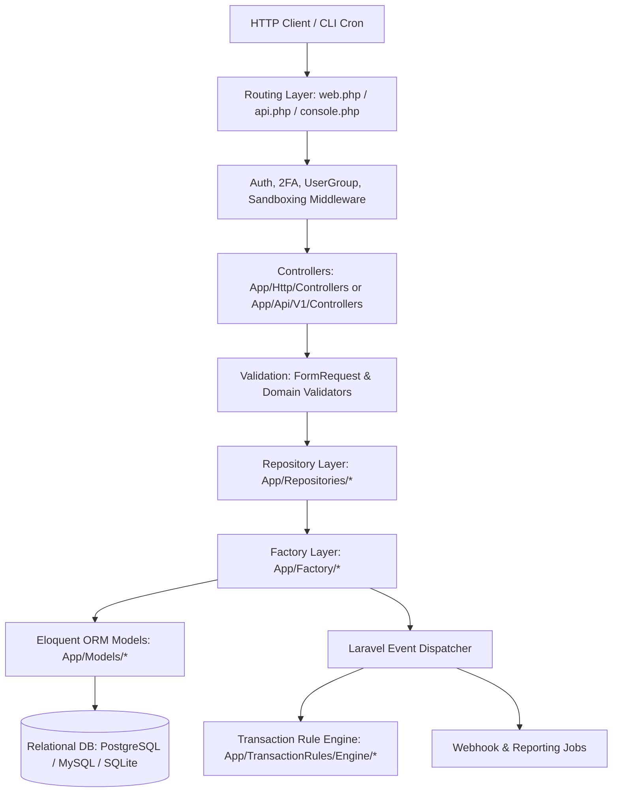

# Phase 1: Firefly III Complete Architecture Analysis

**Target Application:** Firefly III (Open Source Personal Finance Manager)  
**Analyzed Version:** Firefly III v6.x+ (Laravel 13, PHP 8.5+)  
**Workspace Path:** `e:\firefly-iii-main`  
**Target Project:** Mandate Radar (FastAPI + React/Tailwind + PostgreSQL + Neo4j + LLM)

---

## 1. Project Directory Structure

Firefly III follows a customized Laravel enterprise application layout, decoupling API controllers from web controllers and utilizing domain-driven repositories, factories, and rule engines.

```text
firefly-iii-main/
├── app/
│   ├── Api/                       # Dedicated API layer
│   │   └── V1/                    # API v1 Controllers, Requests, Middleware
│   ├── Casts/                     # Eloquent Custom Attribute Casters (e.g. SeparateTimezoneCaster)
│   ├── Console/Commands/          # Artisan CLI commands (Cron, Corrections, Migrations, Integrity)
│   ├── Enums/                     # PHP 8.1+ Enums (AccountTypeEnum, TransactionTypeEnum, etc.)
│   ├── Events/                    # Domain events (Transaction created, updated, deleted, reporting)
│   ├── Exceptions/                # Domain-specific exceptions (DuplicateTransactionException, etc.)
│   ├── Factory/                   # Object factories (TransactionGroupFactory, JournalFactory, etc.)
│   ├── Generator/                 # Chart, Report, and Webhook payload generators
│   ├── Handlers/                  # Observers, Error handlers, Events listeners
│   ├── Helpers/                   # Formatting, currency, and collection helpers
│   ├── Http/
│   │   ├── Controllers/           # Web Blade UI Controllers
│   │   ├── Middleware/            # Session, Auth, Two-Factor, Sandboxing middleware
│   │   └── Requests/              # Web Form Request validation classes
│   ├── Jobs/                      # Asynchronous Queueable Jobs (CreateRecurringTransactions, etc.)
│   ├── Listeners/                 # Event subscribers & listeners
│   ├── Mail/                      # Mailable definitions
│   ├── Models/                    # Eloquent ORM Data Models (Transaction, Journal, Recurrence, Rule, etc.)
│   ├── Notifications/             # User notifications (channels: Mail, Pushover, Slack, Webhook)
│   ├── Providers/                 # Laravel Service Providers
│   ├── Repositories/              # Data access repositories abstracted behind interfaces
│   ├── Rules/                     # Custom Laravel validation rules
│   ├── Services/                  # Internal domain services (Destroy, Update, Recalculate, Password)
│   ├── Support/                   # Core business logic, Cronjobs, Search query parsers
│   ├── TransactionRules/          # Rule processing engine (Triggers, Actions, Expressions)
│   ├── Transformers/              # League Fractal transformers for JSON:API responses
│   └── Validation/                # Domain validators (AccountValidator, etc.)
├── bootstrap/                     # Application bootstrap and service provider registration
├── config/                        # Laravel and Firefly configuration files
├── database/
│   ├── factories/                 # Model factories for testing
│   ├── migrations/                # Schema migrations spanning 2016 to 2024
│   └── seeders/                   # Initial system database seeders
├── public/                        # Web server document root (index.php, static assets)
├── resources/
│   ├── assets/v3/                 # Modern Frontend assets (Vite, Alpine, Tailwind, SASS)
│   └── views/                     # Blade template hierarchy
├── routes/                        # Route definitions (web.php, api.php, console.php)
├── storage/                       # Ephemeral logs, cache, exports, and uploads
└── tests/                         # Unit, Feature, and Integration PHPUnit tests
```

---

## 2. Backend Architecture

Firefly III's backend is built upon a **Domain-Driven Layered Architecture** with strict separation of concerns:



### Key Architectural Layers:
1. **Controllers (`app/Http/Controllers` & `app/Api/V1/Controllers`)**: Thin orchestration layer. They authenticate requests, invoke repositories or factories, and return either Blade views or Fractal transformed JSON.
2. **Repositories (`app/Repositories/*`)**: Every major aggregate root has an explicit interface and Eloquent implementation (e.g., `JournalRepositoryInterface` -> `JournalRepository`). They encapsulate database queries and isolate persistence details.
3. **Factories (`app/Factory/*`)**: Responsible for complex, multi-model entity composition (e.g., creating a `TransactionGroup`, decomposing it into `TransactionJournal`, generating twin credit/debit `Transaction` rows, attaching metadata, categories, and tags).
4. **Service Layer (`app/Services/*`)**: Houses cross-cutting domain mutations that require multi-repository coordination (e.g., `GroupUpdateService`, `RecurrenceUpdateService`, `JournalDestroyService`, `PrimaryAmountRecalculationService`).
5. **Event-Driven Subsystem (`app/Events` & `app/Listeners`)**: State mutations dispatch asynchronous or synchronous events (e.g., `CreatedSingleTransactionGroup`), triggering rule execution, budget recalculations, and webhook notifications.

---

## 3. Frontend Architecture

Firefly III combines **Server-Side Rendered (SSR) Blade templates** with a modern **Client-Side Reactive Asset bundle (v3)** managed via Vite.

- **Asset Location:** `resources/assets/v3/`
- **Build Tool:** `Vite v8.0.0` with `laravel-vite-plugin v3.1`
- **UI Frameworks:** 
  - `AdminLTE 4.0.0` (Dashboard layout, navbar, cards, sidebar)
  - `Bootstrap 5` (Grid system, modals, forms)
  - `Tailwind CSS 4.0.0` (Utility styles)
- **Reactive UI:** 
  - `@alpinejs/csp 3.17.4` (Content Security Policy compliant lightweight component reactivity)
- **Data Visualizations:** 
  - `Chart.js 4.5.1` + `chartjs-plugin-annotation 3.1.0` (Income vs expense line charts, category breakdowns, net worth trajectories)
- **Interactive Components:** 
  - `FullCalendar 7.0.1` (Recurring transaction calendar and bill schedules)
  - `Leaflet 1.9.4` (Geotagged transactions and merchant mapping)
  - `cally 0.9.2` (Modern accessible calendar/date pickers)
  - `bootstrap5-tags` & `bootstrap5-autocomplete` (Dynamic search-as-you-type inputs)
- **State Management & Communication:**
  - `Axios 1.18` (REST API client)
  - `store 2.0.12` (LocalStorage caching for user UI preferences)
  - `i18next 26.0.3` (Client-side localization)

---

## 4. Frameworks and Dependencies

### Backend Dependencies (`composer.json`):
- **Core:** `php: >=8.5`, `laravel/framework: ^13`
- **Database / Numeric Accuracy:** `ext-bcmath` (critical for arbitrary-precision floating-point arithmetic on currency), `ext-pdo`
- **Authentication & Security:** `laravel/passport: ^13.0` (OAuth2 server & Personal Access Tokens), `pragmarx/google2fa: ^9` & `jc5/google2fa-laravel` (Two-Factor TOTP), `thecodingmachine/safe`
- **Date & Period Operations:** `spatie/period: ^2.4`, `nesbot/carbon` (via Laravel)
- **Search & Parsing:** `gdbots/query-parser: ^3.0` (Parses structured search queries like `type:withdrawal amount:>100`), `symfony/expression-language: ^8.0` (Dynamic rule expressions)
- **API Formatting:** `league/fractal: 0.*` (JSON API serializer)

---

## 5. Application Entry Points

1. **Web HTTP Entry Point (`public/index.php`)**:
   - Boots Composer autoloader (`vendor/autoload.php`).
   - Retrieves the Laravel Application instance from `bootstrap/app.php`.
   - Handles the incoming `Illuminate\Http\Request` via `Illuminate\Contracts\Http\Kernel`, running global and route middleware (`web` / `api`).
2. **CLI Entry Point (`artisan`)**:
   - Boots console kernel via `bootstrap/app.php`.
   - Invoked directly by user or by system cron:
     ```bash
     php artisan firefly-iii:cron
     ```
3. **Cron Runner (`app/Console/Commands/Tools/Cron.php`)**:
   - Primary daemon/scheduled orchestrator. Triggers exchange rate updates, recurring transaction generation (`RecurringCronjob`), auto-budgets, bill overdue alerts (`BillWarningCronjob`), and webhook delivery.
4. **API HTTP Route (`routes/api.php`)**:
   - Namespace: `FireflyIII\Api\V1\Controllers`.
   - Secured via `auth:api` (Laravel Passport OAuth2 Bearer Tokens).

---

## 6. Major Modules and Services

| Module | Source Directory / File | Core Responsibility |
| :--- | :--- | :--- |
| **Transaction Engine** | `app/Repositories/TransactionGroup/`<br>`app/Factory/TransactionGroupFactory.php` | Double-entry split transaction creation, validation, storage, and balance updating. |
| **Recurrence Engine** | `app/Repositories/Recurring/`<br>`app/Jobs/CreateRecurringTransactions.php` | Evaluates recurrence schedules (daily, weekly, monthly, N-dom, yearly) and executes transactions. |
| **Bills & Subscriptions** | `app/Repositories/Bill/`<br>`app/Jobs/WarnAboutBills.php` | Matches transactions against expected recurring payments and fires overdue warnings. |
| **Rule Engine** | `app/TransactionRules/`<br>`app/TransactionRules/Engine/SearchRuleEngine.php` | Condition-action engine using Lucene-like AST search triggers and actions. |
| **Search Engine** | `app/Support/Search/`<br>`OperatorQuerySearch.php` | Converts textual search queries into SQL queries across accounts, journals, and tags. |
| **Audit & Integrity** | `app/Console/Commands/Integrity/`<br>`app/Repositories/AuditLogEntry/` | Verifies balance integrity, detects missing linkages, and logs user-level mutations. |

---

## 7. Database Architecture Overview

- **Engine Support:** PostgreSQL (recommended in production), MySQL, MariaDB, SQLite.
- **Ledger Model:** Pure double-entry inspired system. Transactions are not single flat rows; every financial movement consists of:
  1. A logical envelope: `transaction_groups`
  2. A journal entry: `transaction_journals`
  3. Paired ledger postings: `transactions` (one negative/debit on source, one positive/credit on destination).
- **Numeric Precision:** All monetary amounts are defined as `decimal(32, 12)` to prevent any floating-point rounding errors.

---

## 8. API Architecture Overview

- **Specification Standard:** Follows JSON:API concepts serialized using `League\Fractal`.
- **Versioning:** URL path-based versioning (`/api/v1/...`).
- **Authentication:** OAuth2 Personal Access Tokens (`Bearer <token>`) managed via Laravel Passport.
- **Uniform Response Structure:**
  ```json
  {
    "data": {
      "type": "transactions",
      "id": "104",
      "attributes": { "group_title": null, "transactions": [ ... ] },
      "links": { "self": "https://.../api/v1/transactions/104" }
    }
  }
  ```

---

## 9. Architectural Takeaways for Mandate Radar

1. **Adopt Factory + Repository Pattern in Python:** Firefly III's split between `TransactionGroupFactory` (which constructs and validates complex aggregates) and `TransactionGroupRepository` (which handles persistence) avoids bloated controllers. Mandate Radar should adopt this pattern in FastAPI service classes.
2. **Double-Entry Representation for Fintech Mandates:** Every recurring payment or mandate execution must link an Asset Account (user bank account) to an Expense Account (merchant entity), with explicit credit/debit records.
3. **Decouple API from Web UI:** While Firefly III historically merged Blade and Vue/Vite assets, Mandate Radar's separate FastAPI backend and React frontend will deliver cleaner API contracts and stateless scalability.

