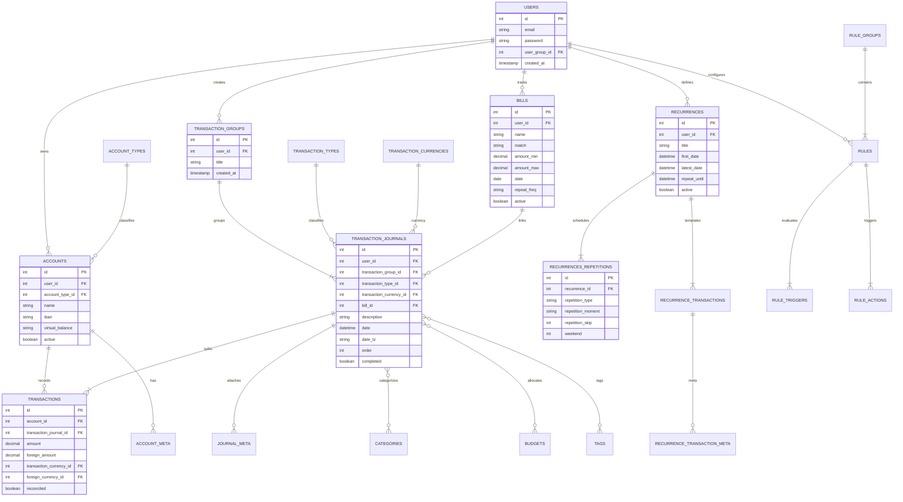

# Phase 5: Firefly III Database Architecture & Schema Analysis

**Target Application:** Firefly III  
**Workspace Location:** `e:\firefly-iii-main`  
**Key Sources Analyzed:**
- `database/migrations/2016_06_16_000000_create_support_tables.php`
- `database/migrations/2016_06_16_000002_create_main_tables.php`
- `database/migrations/2024_03_03_174645_add_indices.php`
- `app/Models/*`

---

## 1. Complete Entity-Relationship (ER) Diagram

---

## 2. Table-by-Table Schema Specification

### 1. `accounts`
Stores financial accounts, counter-parties, and merchants.
- `id` (int, unsigned, PK)
- `user_id` (int, unsigned, FK -> `users.id`)
- `account_type_id` (int, unsigned, FK -> `account_types.id`)
- `name` (varchar 1024)
- `active` (boolean, default true)
- `order` (int)
- `iban` (varchar 34, nullable)
- `bic` (varchar 11, nullable)
- `account_number` (varchar 255, nullable)
- `opening_balance` / `opening_balance_date`
- `virtual_balance` (decimal 32, 12)
- `currency_id` (int, unsigned, nullable)
- SoftDeletes (`deleted_at`), Timestamps (`created_at`, `updated_at`)

### 2. `account_types`
Lookup table defining account roles:
- `Default account` (Asset)
- `Expense account` (Merchant / Vendor)
- `Revenue account` (Employer / Payer)
- `Cash account`
- `Credit card`
- `Loan`, `Debt`, `Mortgage` (Liabilities)
- `Reconciliation account`

### 3. `transaction_groups`
Root container for multi-split or single transactions:
- `id` (int, unsigned, PK)
- `user_id` (int, unsigned, FK -> `users.id`)
- `user_group_id` (int, unsigned, nullable)
- `title` (varchar 1024, nullable)
- SoftDeletes, Timestamps

### 4. `transaction_journals`
Logical transaction event:
- `id` (int, unsigned, PK)
- `user_id` (int, unsigned, FK -> `users.id`)
- `user_group_id` (int, unsigned, nullable)
- `transaction_group_id` (int, unsigned, FK -> `transaction_groups.id`, ON DELETE CASCADE)
- `transaction_type_id` (int, unsigned, FK -> `transaction_types.id`)
- `transaction_currency_id` (int, unsigned, FK -> `transaction_currencies.id`)
- `bill_id` (int, unsigned, nullable, FK -> `bills.id`, ON DELETE SET NULL)
- `description` (varchar 1024)
- `date` (datetime, indexed)
- `date_tz` (varchar 50)
- `order` (int, default 0)
- `completed` (boolean)
- `tag_count` (int, default 0)
- SoftDeletes, Timestamps

### 5. `transactions`
The double-entry ledger lines:
- `id` (int, unsigned, PK)
- `account_id` (int, unsigned, FK -> `accounts.id`, ON DELETE CASCADE)
- `transaction_journal_id` (int, unsigned, FK -> `transaction_journals.id`, ON DELETE CASCADE)
- `amount` (decimal 32, 12): Signed decimal. Negative for outflow, positive for inflow.
- `foreign_amount` (decimal 32, 12, nullable)
- `transaction_currency_id` (int, unsigned, FK -> `transaction_currencies.id`)
- `foreign_currency_id` (int, unsigned, nullable, FK -> `transaction_currencies.id`)
- `reconciled` (boolean, default false)
- `identifier` (varchar 255, nullable)
- SoftDeletes, Timestamps

### 6. `journal_meta`
Extensible metadata key-value storage attached to journals:
- `id` (int, unsigned, PK)
- `transaction_journal_id` (int, unsigned, FK -> `transaction_journals.id`, ON DELETE CASCADE)
- `name` (varchar 255): Key (e.g., `import_hash_v2`, `sepa_ci`, `sepa_db`, `external_id`, `recurrence_id`)
- `data` (text): JSON-encoded payload
- Timestamps

### 7. `recurrences`, `recurrences_repetitions`, `recurrence_transactions`
Schedule definition, frequency rules, and split transaction templates.

### 8. `bills`
Subscription and bill tracking records:
- `id` (int, unsigned, PK)
- `user_id` (int, unsigned, FK -> `users.id`)
- `name` (varchar 1024)
- `match` (text): Comma-separated match words or patterns
- `amount_min` (decimal 32, 12)
- `amount_max` (decimal 32, 12)
- `date` (date): Expected day of month/year
- `repeat_freq` (varchar 50): `weekly`, `monthly`, `quarterly`, `half-year`, `yearly`
- `skip` (int, default 0)
- `automatch` (boolean, default true)
- `active` (boolean, default true)

---

## 3. How Firefly III Models Merchants

Firefly III **does not have a dedicated `merchants` table**.
- Instead, merchants are represented as `accounts` having an `account_type_id` corresponding to `Expense account`.
- When a user pays Netflix, Firefly III creates or retrieves an `accounts` record named `"Netflix"` with type `Expense account`.
- **Limitation for Mandate Radar:** In real-world fintech, an account is not a merchant. A merchant (e.g. Netflix Entertainment Services India LLP) can have multiple UPI handles, multiple billing aggregators (Paytm, BillDesk, Razorpay), multiple subscription plans (Basic, Standard, Premium), and specific cancellation URLs. Modeling merchants as flat expense accounts loses relational and graph fidelity.

---

## 4. Indexing & Query Optimization

Added in `database/migrations/2024_03_03_174645_add_indices.php`:

| Table | Indexed Columns | Query Purpose |
| :--- | :--- | :--- |
| `transaction_journals` | `['user_id', 'user_group_id', 'date', 'transaction_group_id', 'transaction_type_id', 'transaction_currency_id', 'bill_id']` | Critical for fast date-range filtering, user isolation, and bill linkage queries. |
| `transactions` | `['account_id', 'transaction_journal_id', 'transaction_currency_id', 'foreign_currency_id']` | Fast balance joins and journal aggregation. |
| `journal_meta` | `['transaction_journal_id', 'data', 'name']` | Fast duplicate hash lookup (`import_hash_v2`). |
| `accounts` | `['user_id', 'user_group_id', 'account_type_id']` | Filtering user asset accounts vs merchant expense accounts. |

---

## 5. Architectural Recommendations for Mandate Radar's PostgreSQL Schema

1. **Retain Double-Entry Core for Financial Consistency:**
   - Use `accounts` (User Bank Accounts, Credit Cards, UPI Wallets) and `transactions` (Ledger lines).
2. **Introduce Dedicated Entities Firefly III Lacks:**
   - `merchants`: `id`, `legal_name`, `brand_name`, `domain`, `category_id`, `logo_url`, `cancellation_url`, `customer_care_email`.
   - `mandates`: `id`, `user_id`, `merchant_id`, `account_id`, `mandate_type` (`UPI_AUTOPAY`, `E_NACH`, `CARD_SI`), `umn_or_umrn`, `max_amount`, `cadence`, `status` (`ACTIVE`, `PAUSED`, `REVOKED`, `EXPIRED`), `start_date`, `end_date`.
   - `subscription_plans`: `id`, `merchant_id`, `plan_name`, `standard_amount`, `billing_cycle`.
3. **Use JSONB for Raw Data Ingest:**
   - Store raw SMS texts, raw Gmail MIME payloads, and statement PDF extraction blocks in a `raw_ingest_logs` table with `data jsonb` for audit trails and re-processing.

