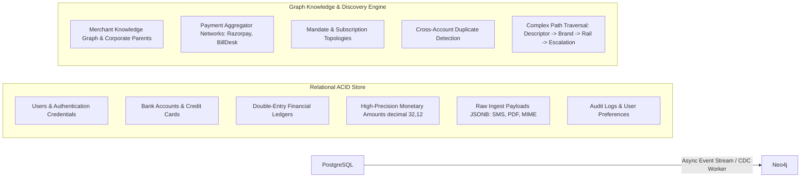
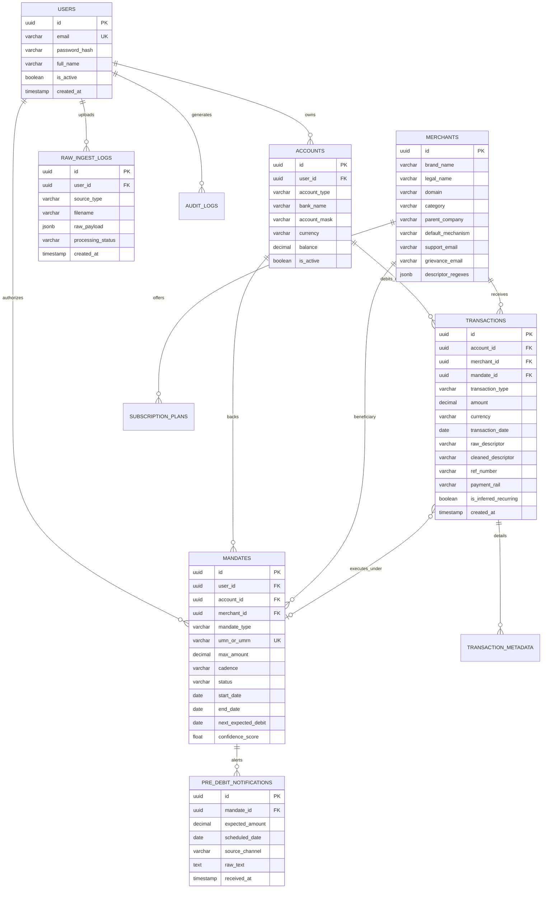
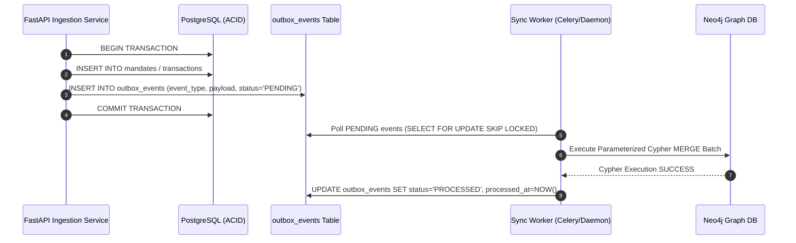

# Database & Neo4j Architecture Blueprint: Mandate Radar

**Document Reference:** `database_and_neo4j_blueprint.md`  
**Author:** Database Architect & Senior Distributed Systems Engineer  
**Target Systems:** PostgreSQL 16+ (Relational / ACID) & Neo4j 5+ (Graph Knowledge Base)  

---

## 1. Architectural Division of Responsibility

A foundational design requirement is establishing clear boundaries between **PostgreSQL** and **Neo4j** to prevent redundant duplication and optimize each engine for its strengths.



### Partitioning Rules:
1. **Never store micro-ledger lines in Neo4j:** Graph databases do not provide arbitrary-precision arithmetic (`decimal(32,12)`) and will suffer memory exhaustion if storing millions of historical bank transaction lines.
2. **PostgreSQL holds the System of Record:** If Neo4j is deleted or corrupted, the entire graph can be deterministically re-projected from PostgreSQL tables.
3. **Neo4j holds Topological Intelligence:** Relational queries become prohibitively slow when traversing dynamic depths (e.g. finding if two different transaction strings resolve to subsidiaries of the same parent company). Neo4j executes these path traversals in single-digit milliseconds.

---

## 2. PostgreSQL Relational Schema Blueprint

### 2.1 Relational ER Diagram



### 2.2 Table Definitions and Data Types

#### 1. `users`
- `id`: `UUID PRIMARY KEY DEFAULT gen_random_uuid()`
- `email`: `VARCHAR(255) UNIQUE NOT NULL`
- `password_hash`: `VARCHAR(255) NOT NULL` (Argon2id)
- `full_name`: `VARCHAR(255) NOT NULL`
- `is_active`: `BOOLEAN DEFAULT TRUE`
- `created_at`: `TIMESTAMPTZ DEFAULT NOW()`
- `updated_at`: `TIMESTAMPTZ DEFAULT NOW()`

#### 2. `accounts` (User Payment Instruments)
- `id`: `UUID PRIMARY KEY DEFAULT gen_random_uuid()`
- `user_id`: `UUID NOT NULL REFERENCES users(id) ON DELETE CASCADE`
- `account_type`: `VARCHAR(50) NOT NULL` (`SAVINGS`, `CURRENT`, `CREDIT_CARD`, `UPI_WALLET`)
- `bank_name`: `VARCHAR(100) NOT NULL` (e.g. `HDFC Bank`, `ICICI Bank`)
- `account_mask`: `VARCHAR(10) NOT NULL` (e.g. `**4821`)
- `currency`: `VARCHAR(3) DEFAULT 'INR'`
- `virtual_balance`: `DECIMAL(32, 12) DEFAULT 0.0`
- `is_active`: `BOOLEAN DEFAULT TRUE`

#### 3. `merchants`
- `id`: `UUID PRIMARY KEY DEFAULT gen_random_uuid()`
- `brand_name`: `VARCHAR(255) NOT NULL` (e.g. `YouTube Premium`)
- `legal_name`: `VARCHAR(255)` (e.g. `Google Ireland Ltd`)
- `domain`: `VARCHAR(255)` (e.g. `youtube.com`)
- `category`: `VARCHAR(100) NOT NULL` (e.g. `Entertainment & Streaming`)
- `parent_company`: `VARCHAR(255)` (e.g. `Alphabet Inc.`)
- `default_mechanism`: `VARCHAR(50)` (e.g. `PLAY_STORE`, `UPI_AUTOPAY`)
- `support_email`: `VARCHAR(255)`
- `grievance_email`: `VARCHAR(255)`
- `cancellation_pitfall`: `TEXT`
- `descriptor_regexes`: `JSONB NOT NULL DEFAULT '[]'::jsonb`

#### 4. `mandates`
- `id`: `UUID PRIMARY KEY DEFAULT gen_random_uuid()`
- `user_id`: `UUID NOT NULL REFERENCES users(id) ON DELETE CASCADE`
- `account_id`: `UUID NOT NULL REFERENCES accounts(id) ON DELETE RESTRICT`
- `merchant_id`: `UUID REFERENCES merchants(id) ON DELETE SET NULL`
- `mandate_type`: `VARCHAR(50) NOT NULL` (`UPI_AUTOPAY`, `BANK_NACH`, `CARD_SI`, `INFERRED_RECURRING`)
- `umn_or_umrn`: `VARCHAR(100)` (Unique Mandate Number or UMRN)
- `max_amount`: `DECIMAL(32, 12) NOT NULL`
- `latest_billed_amount`: `DECIMAL(32, 12)`
- `cadence`: `VARCHAR(50) NOT NULL` (`MONTHLY`, `QUARTERLY`, `ANNUAL`)
- `status`: `VARCHAR(50) NOT NULL` (`PENDING_VERIFICATION`, `ACTIVE`, `PAUSED`, `REVOKED`, `EXPIRED`)
- `flag`: `VARCHAR(50) DEFAULT 'HEALTHY'` (`HEALTHY`, `PRICE_HIKE`, `TRIAL_CONVERTED`, `UNUSED_ZOMBIE`)
- `flag_reason`: `TEXT`
- `confidence_score`: `FLOAT NOT NULL DEFAULT 1.0`
- `next_expected_debit`: `DATE`
- `created_at`: `TIMESTAMPTZ DEFAULT NOW()`

#### 5. `transactions`
- `id`: `UUID PRIMARY KEY DEFAULT gen_random_uuid()`
- `user_id`: `UUID NOT NULL REFERENCES users(id) ON DELETE CASCADE`
- `account_id`: `UUID NOT NULL REFERENCES accounts(id) ON DELETE CASCADE`
- `merchant_id`: `UUID REFERENCES merchants(id) ON DELETE SET NULL`
- `mandate_id`: `UUID REFERENCES mandates(id) ON DELETE SET NULL`
- `transaction_type`: `VARCHAR(20) NOT NULL` (`DEBIT`, `CREDIT`)
- `amount`: `DECIMAL(32, 12) NOT NULL`
- `currency`: `VARCHAR(3) DEFAULT 'INR'`
- `transaction_date`: `DATE NOT NULL`
- `raw_descriptor`: `TEXT NOT NULL`
- `cleaned_descriptor`: `TEXT NOT NULL`
- `ref_number`: `VARCHAR(100)` (UTR / UPI Ref / Cheque No)
- `payment_rail`: `VARCHAR(50) NOT NULL`
- `is_inferred_recurring`: `BOOLEAN DEFAULT FALSE`
- `created_at`: `TIMESTAMPTZ DEFAULT NOW()`

#### 6. `raw_ingest_logs`
- `id`: `UUID PRIMARY KEY DEFAULT gen_random_uuid()`
- `user_id`: `UUID NOT NULL REFERENCES users(id) ON DELETE CASCADE`
- `source_type`: `VARCHAR(50) NOT NULL` (`STATEMENT_PDF`, `STATEMENT_CSV`, `SMS_STREAM`, `GMAIL_API`)
- `filename`: `VARCHAR(255)`
- `raw_payload`: `JSONB NOT NULL`
- `records_extracted`: `INTEGER DEFAULT 0`
- `processing_status`: `VARCHAR(50) DEFAULT 'PENDING'` (`PENDING`, `COMPLETED`, `FAILED`)
- `error_message`: `TEXT`
- `created_at`: `TIMESTAMPTZ DEFAULT NOW()`

---

## 3. Neo4j Graph Schema Blueprint

### 3.1 Graph Model Diagram

```mermaid
flowchart LR
    Person[Person: (:Person)]
    Account[Account: (:Account)]
    Mandate[Mandate: (:Mandate)]
    Merchant[Merchant: (:Merchant)]
    Parent[Parent: (:Parent)]
    Mechanism[Mechanism: (:Mechanism)]
    Aggregator[Aggregator: (:Aggregator)]
    Descriptor[Descriptor: (:Descriptor)]
    Escalation[EscalationStep: (:EscalationStep)]

    Person -->|OWNS| Account
    Account -->|ISSUED_MANDATE| Mandate
    Mandate -->|FOR| Merchant
    Mandate -->|VIA_MECHANISM| Mechanism
    Merchant -->|OWNED_BY| Parent
    Merchant -->|BILLED_VIA| Aggregator
    Descriptor -->|RESOLVES_TO| Merchant
    Mechanism -->|ESCALATES_TO| Escalation
```

### 3.2 Node Specifications
1. **`(:Person)`**
   - `id`: UUID (matching `users.id`)
   - `name`: String
2. **`(:Account)`**
   - `id`: UUID (matching `accounts.id`)
   - `bank_name`: String
   - `account_mask`: String
3. **`(:Mandate)`**
   - `id`: UUID (matching `mandates.id`)
   - `umn_or_umrn`: String
   - `mandate_type`: String (`"UPI_AUTOPAY"`, `"BANK_NACH"`, `"CARD_SI"`)
   - `cadence`: String
   - `amount`: Float
   - `status`: String (`"ACTIVE"`, `"PAUSED"`, `"REVOKED"`)
   - `flag`: String (`"HEALTHY"`, `"PRICE_HIKE"`, `"TRIAL_CONVERTED"`, `"UNUSED_ZOMBIE"`)
4. **`(:Merchant)`**
   - `id`: UUID (or slug e.g. `"youtube_premium"`)
   - `name`: String
   - `category`: String
   - `website`: String
5. **`(:Parent)`**
   - `id`: String (e.g. `"alphabet"`, `"amazon"`, `"meta"`)
   - `name`: String (e.g. `"Alphabet Inc."`)
6. **`(:Aggregator)`**
   - `name`: String (e.g. `"Razorpay"`, `"BillDesk"`, `"Paytm Gateway"`, `"Cashfree"`)
7. **`(:Mechanism)`**
   - `id`: String (`"UPI_AUTOPAY"`, `"BANK_NACH"`, `"CARD_SI"`, `"PLAY_STORE"`, `"APP_STORE"`)
   - `name`: String
8. **`(:Descriptor)`**
   - `pattern`: String (Regex pattern)

---

## 4. High-Value Cypher Graph Queries

### Query 1: Detect Duplicate Active Subscriptions across Different User Accounts
Finds scenarios where a single user is paying for the same merchant through multiple different bank accounts or credit cards (e.g. Hotstar billed to both an HDFC Savings Account and an ICICI Credit Card).

```cypher
MATCH (p:Person {id: $user_id})-[:OWNS]->(a:Account)-[:ISSUED_MANDATE]->(m:Mandate {status: 'ACTIVE'})-[:FOR]->(merc:Merchant)
WITH merc, collect(a.bank_name + ' ' + a.account_mask) AS accounts_charged, collect(m) AS active_mandates, count(m) AS sub_count
WHERE sub_count > 1
RETURN 
    merc.name AS merchant_name,
    sub_count AS duplicate_count,
    accounts_charged,
    [m IN active_mandates | m.amount] AS amounts_billed,
    [m IN active_mandates | m.cadence] AS frequencies;
```

### Query 2: Aggregate Corporate Spend Footprint
Aggregates total annual committed financial spend grouped by the ultimate parent corporation (e.g., combining YouTube Premium, Google One, Google Workspace under Alphabet Inc.).

```cypher
MATCH (p:Person {id: $user_id})-[:OWNS]->(:Account)-[:ISSUED_MANDATE]->(m:Mandate {status: 'ACTIVE'})-[:FOR]->(merc:Merchant)-[:OWNED_BY]->(parent:Parent)
RETURN 
    parent.name AS corporate_parent,
    collect(DISTINCT merc.name) AS subscribed_services,
    count(m) AS total_mandates,
    sum(CASE m.cadence 
        WHEN 'MONTHLY' THEN m.amount * 12.0 
        WHEN 'QUARTERLY' THEN m.amount * 4.0 
        ELSE m.amount END) AS total_annual_committed
ORDER BY total_annual_committed DESC;
```

### Query 3: Payment Aggregator Unmasking
Resolves ambiguous bank descriptors referencing third-party payment aggregators to their true underlying merchants.

```cypher
MATCH (agg:Aggregator)<-[:BILLED_VIA]-(m:Merchant)
WHERE $raw_descriptor CONTAINS toUpper(agg.name) 
  AND ($raw_descriptor CONTAINS toUpper(m.name) OR any(alias IN m.aliases WHERE $raw_descriptor CONTAINS toUpper(alias)))
RETURN 
    m.id AS resolved_merchant_id,
    m.name AS canonical_merchant_name,
    agg.name AS payment_gateway;
```

---

## 5. PostgreSQL-to-Neo4j Synchronization Strategy

To guarantee data consistency without coupling relational transaction commits to graph database availability, Mandate Radar implements an **Asynchronous Outbox / Event Bus Pattern**:



### Idempotent Cypher Sync Batch
```cypher
UNWIND $batch AS event
MATCH (p:Person {id: event.user_id})
MERGE (a:Account {id: event.account_id})
  ON CREATE SET a.bank_name = event.bank_name, a.account_mask = event.account_mask
MERGE (p)-[:OWNS]->(a)
MERGE (m:Mandate {id: event.mandate_id})
  ON CREATE SET 
    m.amount = event.amount,
    m.cadence = event.cadence,
    m.status = event.status,
    m.flag = event.flag,
    m.umn_or_umrn = event.umn_or_umrn
  ON MATCH SET
    m.amount = event.amount,
    m.status = event.status,
    m.flag = event.flag
MERGE (a)-[:ISSUED_MANDATE]->(m)
WITH m, event
MATCH (merc:Merchant {id: event.merchant_id})
MERGE (m)-[:FOR]->(merc);
```

---

## 6. Indexing and Performance Recommendations

### PostgreSQL Indexes
```sql
-- 1. Fast transaction ledger retrieval per account and user
CREATE INDEX idx_transactions_user_account_date 
ON transactions (user_id, account_id, transaction_date DESC);

-- 2. Fast mandate lookups by status
CREATE INDEX idx_mandates_user_status 
ON mandates (user_id, status);

-- 3. Unique Mandate Reference index (enforcing uniqueness where present)
CREATE UNIQUE INDEX idx_mandates_umn_unique 
ON mandates (umn_or_umrn) WHERE umn_or_umrn IS NOT NULL;

-- 4. Ingest logs status polling
CREATE INDEX idx_raw_ingest_pending 
ON raw_ingest_logs (processing_status, created_at) 
WHERE processing_status = 'PENDING';

-- 5. Outbox queue worker index
CREATE INDEX idx_outbox_pending 
ON outbox_events (status, created_at) 
WHERE status = 'PENDING';
```

### Neo4j Schema Constraints and Indexes
```cypher
// 1. Uniqueness constraints
CREATE CONSTRAINT unique_person_id IF NOT EXISTS
FOR (p:Person) REQUIRE p.id IS UNIQUE;

CREATE CONSTRAINT unique_account_id IF NOT EXISTS
FOR (a:Account) REQUIRE a.id IS UNIQUE;

CREATE CONSTRAINT unique_mandate_id IF NOT EXISTS
FOR (m:Mandate) REQUIRE m.id IS UNIQUE;

CREATE CONSTRAINT unique_merchant_id IF NOT EXISTS
FOR (m:Merchant) REQUIRE m.id IS UNIQUE;

// 2. Lookup Indexes
CREATE INDEX idx_merchant_name IF NOT EXISTS
FOR (m:Merchant) ON (m.name);

CREATE INDEX idx_mandate_status IF NOT EXISTS
FOR (m:Mandate) ON (m.status);
```

