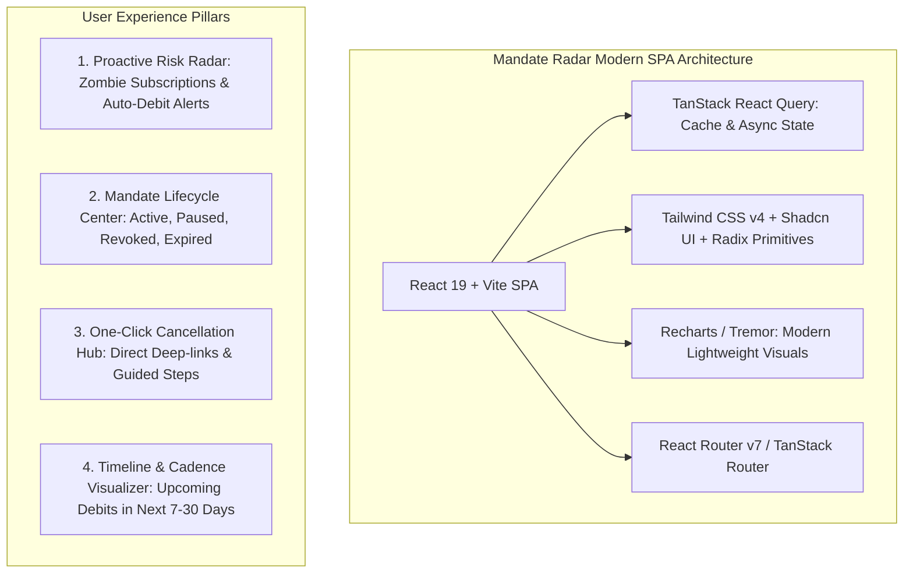

# Phase 7: Firefly III Frontend & UI/UX Analysis

**Target Application:** Firefly III  
**Workspace Location:** `e:\firefly-iii-main`  
**Key Sources Analyzed:**
- `resources/assets/v3/` (Vite, Tailwind CSS 4, Bootstrap 5, AdminLTE 4, Alpine.js CSP)
- `resources/views/*` (Blade templates for layouts, dashboards, transactions, accounts, recurrences)
- `resources/assets/v3/js/pages/transactions/*`, `resources/assets/v3/js/pages/recurring/*`

---

## 1. Frontend Architecture & Technology Stack

Firefly III v3 utilizes a **Hybrid Multi-Page Application (MPA)** architecture:

```text
Backend Blade SSR (HTML Shell + Layout)
       │
       └── Asset Pipeline: Vite 8.0.0 + PostCSS
             ├── AdminLTE 4.0.0 (Sidebar, Header, Admin Theme)
             ├── Bootstrap 5 (Responsive Grid, Modals, Forms)
             ├── Tailwind CSS 4.0.0 (Utility Styles)
             ├── Alpine.js CSP 3.17 (Scoped Component Reactivity)
             ├── Chart.js 4.5.1 (Data Visualizations)
             ├── FullCalendar 7.0.1 (Recurring Event Scheduling)
             └── Leaflet 1.9.4 (Geographical Transaction Mapping)
```

### Strengths of the Hybrid MPA Architecture:
1. **Content Security Policy (CSP) Compliance:** Uses `@alpinejs/csp` avoiding `eval()` and `new Function()`, preventing script-injection vulnerabilities.
2. **Fast Initial Load:** Server renders HTML tables and metrics directly via Blade, avoiding initial blank-screen load states.
3. **Decoupled JavaScript Modules:** Modular JS files in `resources/assets/v3/js/pages/` load conditionally based on the active route.

---

## 2. Key Screen Architectures

### A. Main Financial Dashboard (`resources/views/index.blade.php`)
- **Visual Hierarchy:**
  - Top summary cards: Net worth, monthly cashflow balance (Income vs Expenses), bill summary.
  - Middle section: Interactive Chart.js canvas showing daily balance trends with past history vs future projections.
  - Bottom grid: Account balances (Asset accounts, Credit card debt), upcoming recurring transactions, active budget meters.

### B. Transaction Creation & Split Screens (`resources/views/transactions/create.blade.php`)
- Supports dynamic multi-split items.
- Real-time client-side total recalculation: as split lines are added or edited, Alpine.js dynamically computes the remaining balance to balance debit/credit entries.
- Typeahead integration: `bootstrap5-autocomplete` connects to `/api/v1/autocomplete/accounts` and `/api/v1/autocomplete/categories`.
- Geolocation: Embedded Leaflet map allows pinpointing merchant locations or auto-fills from browser GPS.

### C. Recurring Transaction & Subscription Screens (`resources/views/recurring/`)
- Schedule Builder: Dropdowns for frequency (`daily`, `weekly`, `monthly`, `ndom`, `yearly`), interval skip, and weekend adjustments (Shift to Friday/Monday).
- Calendar Preview: `FullCalendar` visualizes upcoming execution dates up to 12 months ahead, allowing users to verify recurrence rules before activating them.

### D. Rules Manager Screen (`resources/views/rules/`)
- Visual rule builder with dynamic "+ Add Trigger" and "+ Add Action" rows.
- Strict / Non-Strict toggle (AND / OR conditions).
- Drag-and-drop rule reordering to control execution precedence.

---

## 3. UI/UX Limitations of Firefly III

1. **Information Density Overload:** Firefly III is heavily accounting-centric. Dashboards present dense data tables with complex accounting jargon (asset vs liability, reconciled vs cleared), which intimidates non-technical users.
2. **Desktop-First Bias:** Although Bootstrap provides responsiveness, multi-split transaction forms and the rule builder are cumbersome on mobile viewports.
3. **Passive Display instead of Actionable Intelligence:** Firefly III displays what *has happened*. It lacks proactive recommendations (e.g. "You have 3 unused streaming subscriptions totaling ₹1,499/month; tap here to cancel").

---

## 4. Designing a Superior Financial Intelligence Dashboard for Mandate Radar (React + Tailwind CSS)

Mandate Radar is not a general personal accounting ledger; it is a **Mandate & Subscription Intelligence Sentinel**.



### UI/UX Recommendations for Mandate Radar:
1. **Radar Risk Banner ("Urgent Action Center"):**
   - High-visibility banner highlighting imminent charges: *"₹999 will be auto-debited tomorrow via UPI AutoPay for Hotstar. You haven't used this in 45 days. [Cancel Mandate]"*.
2. **Unified Mandate Cards (UPI AutoPay & NACH):**
   - Distinctive mandate badges: Green (Active), Amber (Action Required / Price Hiked), Red (Failed / Overdue).
   - Display UMN / UMRN tokens, mandate maximum cap vs actual billed amount, and linked bank account.
3. **One-Click Cancellation Flow:**
   - Instead of just deleting the record, provide an interactive cancellation drawer:
     - Direct deep-link to the bank/UPI app mandate management screen (Google Pay, PhonePe, Paytm, HDFC, ICICI).
     - Auto-generated formal cancellation email template addressed to merchant customer support.
     - Step-by-step RBI-compliant mandate revocation checklist.
4. **Interactive Graph Visualizer:**
   - Incorporate a React Flow or Force-Graph component powered by Neo4j data, visualizing how multiple subscription plans branch out from single payment instruments.

