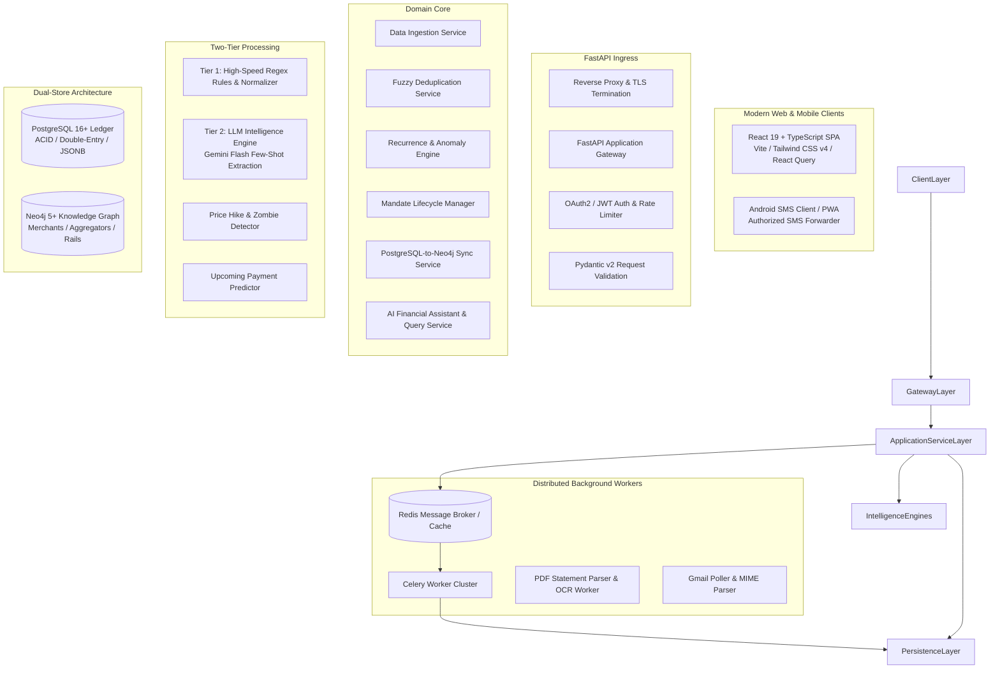
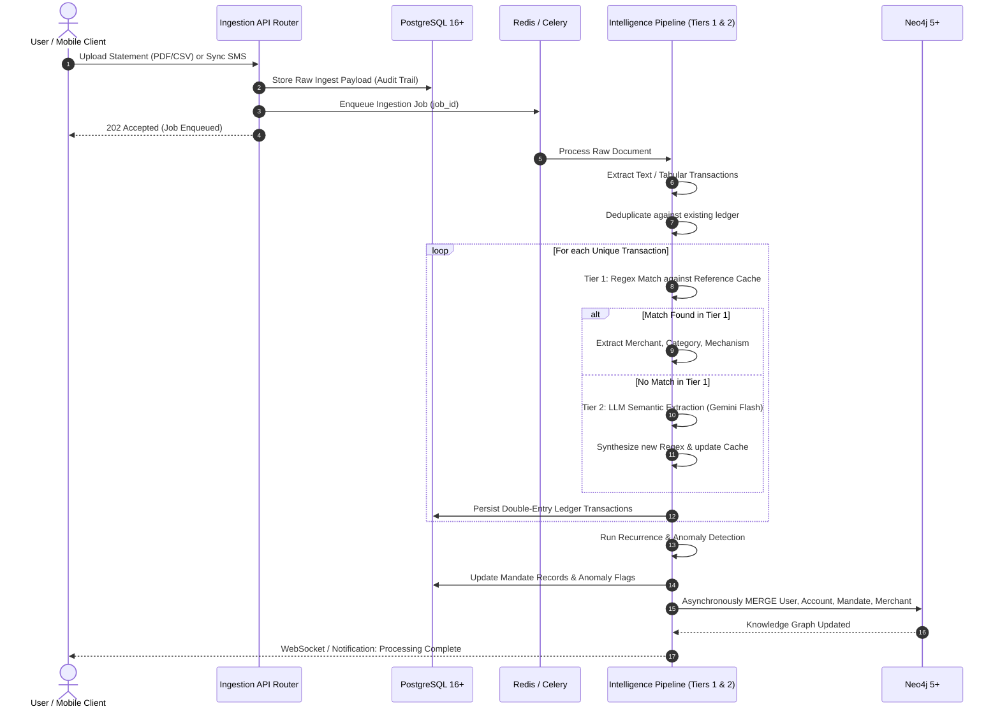

# Improved System Architecture: Mandate Radar 2.0

**Document Reference:** `improved_architecture.md`  
**Author:** Principal Software Architect & Financial Systems Specialist  
**Target Application:** Mandate Radar (Enterprise Fintech Edition)  

---

## 1. Architectural Vision and Core Principles

Mandate Radar is transformed from an in-memory prototype into an **intelligent, multi-channel financial commitment sentinel**.

### Core Architectural Principles:
1. **Separation of System of Record vs. System of Intelligence:**
   - **PostgreSQL 16+ (System of Record):** Handles ACID transactions, double-entry financial ledgers, user authentication, raw document storage, and audit logs.
   - **Neo4j 5+ (System of Intelligence):** Models merchant knowledge topologies, corporate ownership hierarchies, payment aggregator routing, and cross-account subscription clustering.
2. **Domain-Driven Layered Architecture:**
   - Decouples API controllers from business logic via dedicated Service, Factory, and Repository layers (inspired by Firefly III's clean domain structure).
3. **Two-Tier Hybrid Intelligence Pipeline:**
   - Combines sub-millisecond deterministic regex rules (Tier 1) with LLM semantic extraction fallbacks (Tier 2 - Google Gemini Flash) for uncataloged transactions.
4. **Multi-Source Deduplication & Normalization:**
   - Unifies fragmented data from bank statements (PDF/CSV), authorized SMS alerts, and Gmail receipts into normalized, deduplicated ledger transactions.
5. **Strict Mandate Taxonomy:**
   - Maintains rigorous ontological separation between:
     - *Inferred Recurring Payments* (statistical observations).
     - *Inferred Subscriptions* (recurring payments mapped to known digital services).
     - *Verified Auto-Debit Mandates* (contractually standing instructions backed by NPCI UMN/UMRN tokens).

---

## 2. High-Level System Architecture Diagram

---

## 3. Layered Architectural Decomposition

### 3.1 Presentation Layer (Frontend)
- **Framework:** React 19 + TypeScript bundled via Vite.
- **State Management & Data Fetching:** 
  - `@tanstack/react-query`: Provides automated caching, background refetching, and optimistic updates for financial portfolios.
  - Context / Zustand: Lightweight global UI state (theme, user preferences, active filters).
- **Navigation:** `@tanstack/react-router` or `react-router-dom v7` providing typed URL routes (`/dashboard`, `/mandates`, `/mandates/:id`, `/graph`, `/upload`, `/settings`).
- **Visualizations:**
  - Modernized `RadarView.tsx` with animated commitment meters.
  - Upgraded `GraphCanvas.tsx` with WebGL or Canvas rendering for multi-thousand node topologies.
  - Interactive SVG sparklines and payment timeline calendars.

### 3.2 Gateway & Security Layer
- **FastAPI Middleware Stack:**
  - `CORSMiddleware`: Strict domain whitelisting (replacing wildcard `*`).
  - `JWTMiddleware`: Validates Bearer access tokens on all `/api/v1/*` routes.
  - `RateLimiter`: Sliding window rate limiter backed by Redis (preventing brute-force attacks on extraction endpoints).
  - `SecurityHeaders`: Injects strict CSP, HSTS, X-Content-Type-Options, and X-Frame-Options headers.

### 3.3 Domain Service Layer (Backend Services)

Following Firefly III's best practices, business logic is isolated into domain service classes inside `backend/app/services/`:

1. **`IngestionService` (`app/services/ingestion.py`):**
   - Coordinates file and payload intake from CSV, PDF, SMS, and Gmail.
   - Dispatches raw documents to `raw_ingest_logs` in PostgreSQL before processing.
2. **`DeduplicationService` (`app/services/deduplication.py`):**
   - Executes multi-channel fuzzy deduplication. Matches candidates using a sliding temporal window ($\pm 2$ days), amount equality ($|\Delta| < 0.01$), and normalized merchant string distance.
3. **`TransactionService` (`app/services/transaction.py`):**
   - Manages double-entry journal creation via a `TransactionFactory`.
   - Records debits against user `Account` records and credits against `Merchant` records.
4. **`MandateService` (`app/services/mandate.py`):**
   - Tracks the full lifecycle of UPI AutoPay and NACH mandates (`PENDING_VERIFICATION`, `ACTIVE`, `PAUSED`, `REVOKED`, `EXPIRED`).
   - Links pre-debit notifications to active mandate records.
5. **`SyncService` (`app/services/sync.py`):**
   - Asynchronously projects entities from PostgreSQL to Neo4j.
   - Generates idempotent Cypher `MERGE` queries to maintain node and edge consistency.

### 3.4 Asynchronous Worker Subsystem
- **Task Broker:** Redis 7+.
- **Task Runner:** Celery or ARQ (async Python worker).
- **Scheduled Tasks (Cron Jobs):**
  - `daily_pre_debit_scanner`: Runs daily at 06:00 IST; matches pre-debit notifications against expected payments and sends push alerts for unexpected charges.
  - `zombie_subscription_auditor`: Evaluates user inactivity against recurring debits every Monday.
  - `gmail_periodic_sync`: Syncs unread billing emails for authenticated users every 6 hours.

---

## 4. End-to-End Data Ingestion and Processing Pipeline

---

## 5. Architectural Quality Attributes & Design Principles

### 5.1 Reliability and ACID Guarantees
- Financial records are strictly stored in PostgreSQL with foreign keys and database transactions.
- A failure in Neo4j or Redis will **never** cause data loss in the core financial ledger. The sync service automatically replays un-synced events when the graph database recovers.

### 5.2 Performance & Scalability
- **Sub-50ms API Responses:** Read queries for user dashboards read pre-aggregated metrics from PostgreSQL indexes or Redis caches.
- **Batched Graph Synchronization:** Neo4j updates are executed in batches using `UNWIND $batch AS item` to minimize Bolt round-trips.
- **CPU Offloading:** Document parsing (PDF table extraction and OCR) executes in Celery worker processes outside the asynchronous FastAPI event loop.

### 5.3 Extensibility
- Adding a new payment rail (e.g. Account Aggregator / CBDC e-Rupee) requires only implementing a new ingestion parser and adding the mechanism node to the Neo4j ontology.
- Adding a new merchant requires updating the Neo4j merchant database or letting Tier 2 LLM auto-discover the brand without changing application source code.

