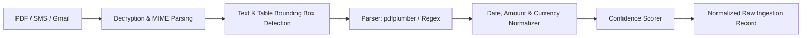

# Intelligence Engine Specifications: Mandate Radar

**Document Reference:** `intelligence_engine_design.md`  
**Author:** Principal Software Architect, Senior Fintech Engineer & AI Systems Lead  
**Scope:** Complete Architectural Specification for Engines 1 through 8  

---

## 1. Executive Overview

Mandate Radar is engineered as an **eight-tier intelligence platform**. Rather than treating financial transactions as generic rows in a database, each engine specializes in a distinct stage of the data lifecycle: from raw unstructured document parsing to predictive graph analytics and verified conversational AI.

```mermaid
flowchart TD
    Raw[Raw Ingestion Feeds: PDF, SMS, Gmail, CSV] --> E1[Engine 1: Financial Data Extraction]
    E1 --> E2[Engine 2: Transaction Intelligence & Deduplication]
    E2 --> E3[Engine 3: Recurring Payment Detection]
    E3 --> E4[Engine 4: Subscription Intelligence]
    E3 --> E5[Engine 5: Mandate Intelligence (UPI / NACH Verification)]
    E4 & E5 --> E6[Engine 6: Financial Graph Intelligence (Neo4j)]
    E6 --> E7[Engine 7: Financial Intelligence & Predictive Analytics]
    E7 --> E8[Engine 8: AI Financial Assistant (Verified Natural Language Q&A)]
```

---

## 2. Engine 1: Financial Data Extraction Engine

### 2.1 Objectives and Ingestion Sources
Extracts structured financial transactions from diverse real-world unstructured sources:
1. **Password-Protected Bank Statement PDFs:** Decrypts statements using user-supplied credentials (DOB in `DDMMYYYY` or PAN), extracts tabular lines across multi-page boundaries.
2. **Authorized Android SMS Alerts:** Ingests bank debit notifications (`VK-HDFCBK`, `AD-ICICIB`, `AX-AXISBK`) and UPI transaction confirmations.
3. **Gmail Financial Invoices & Pre-Debit Notices:** Ingests digital invoices (Google Play, Apple, AWS, Netflix) and mandatory 24-hour pre-debit notifications via restricted Google Workspace OAuth2.
4. **Bank Statement CSVs:** Dynamic delimiter and column header mapping.

### 2.2 Extraction Architecture & Pipeline


### 2.3 Date, Amount, and Currency Normalization
- **Date Normalization:** Robust parsing across heterogeneous Indian banking formats:
  - `DD/MM/YYYY`, `DD-MM-YYYY`, `DD-Mon-YYYY` (e.g. `15-Jan-2026`), `YYYY-MM-DD`. Standardized into ISO-8601 (`YYYY-MM-DD`).
- **Amount & Currency Normalization:**
  - Removes currency symbols (`₹`, `Rs.`, `INR`, `$`, `USD`).
  - Cleans thousand separators (`1,49,000.00` $\rightarrow$ `149000.00`).
  - Converts signed values to absolute decimal values and explicitly tags transaction direction (`DEBIT` vs `CREDIT`).
- **Confidence Scoring:** Assigns an extraction confidence score $S \in [0.0, 1.0]$. A statement where total debits reconcile with `Opening Balance - Closing Balance` receives $S = 1.0$; an unverified OCR receipt receives $S = 0.70$.

---

## 3. Engine 2: Transaction Intelligence Engine

### 3.1 Objectives
Transforms raw, messy transaction records into canonical, categorized financial events, cleans payment aggregator tokens, and eliminates cross-channel duplicates.

### 3.2 Merchant Descriptor Cleaning & Aggregator Stripping
Indian banking descriptors frequently conceal the true merchant behind payment aggregators and terminal IDs:
- Raw: `POS 492014*RAZORPAY*SWIGGY BLR IN 2026-01-15`
- Aggregator Extraction: Detects aggregator token `RAZORPAY`.
- Strip Aggregator & Terminal Prefixes: Removes `POS \d+`, `UPI/\d+/`, `BILLDESK\*`, `PAYTM\*`.
- Cleaned Descriptor: `SWIGGY BLR`.

### 3.3 Merchant Alias Resolution & Canonical Mapping
Maps variations to a single verified entity:
- Variations: `NETFLIX MUMBAI`, `NETFLIX.COM`, `PAYTM*NETFLIX`, `NETFLIX ENTERTAINMENT SVCS` $\rightarrow$ Canonical Merchant: `Netflix India` (ID: `netflix_india`).

### 3.4 Multi-Source Time-Windowed Fuzzy Deduplication
When transactions arrive simultaneously from SMS, statement PDF, and Gmail, exact hash deduplication fails. Engine 2 executes sliding-window matching:
```python
def is_duplicate(candidate, existing_records):
    for tx in existing_records:
        if tx.account_id == candidate.account_id and abs(tx.amount - candidate.amount) < 0.01:
            date_diff = abs((tx.date - candidate.date).days)
            if date_diff <= 2: # 48-hour tolerance window
                similarity = string_similarity(candidate.cleaned_merchant, tx.cleaned_merchant)
                if similarity > 0.85 or (tx.ref_number and tx.ref_number == candidate.ref_number):
                    return True, tx
    return False, None
```

---

## 4. Engine 3: Recurring Payment Detection Engine

### 4.1 Objectives
Identifies repeating financial payment patterns over time. **Critical Rule:** Engine 3 does *not* assume every repeating payment is a subscription.

### 4.2 Statistical Interval & Cadence Inference
Evaluates consecutive transaction timestamps for each resolved merchant group:
- Calculates interval $\Delta t_i = t_i - t_{i-1}$ in days.
- Computes interval median $\tilde{\Delta}$ and coefficient of variation $CV = \sigma / \mu$.
- **Cadence Tolerances:**
  - **Monthly:** $25 \le \tilde{\Delta} \le 35$ days, $CV < 0.20$.
  - **Quarterly:** $82 \le \tilde{\Delta} \le 98$ days, $CV < 0.15$.
  - **Annual:** $350 \le \tilde{\Delta} \le 380$ days, $CV < 0.10$.
  - **Bi-Weekly / Fortnightly:** $13 \le \tilde{\Delta} \le 16$ days.

### 4.3 Handling Variable Amounts & Missed Payments
- **Variable Amount Handling (Utility vs Subscription):** If intervals are monthly but amount variance is high ($CV_{\text{amount}} > 0.25$), classifies as a *Variable Utility / Bill* rather than a fixed commitment.
- **Missed Payment Recovery:** If a single gap is approximately $2 \times \tilde{\Delta}$ (e.g. 58–62 days), Engine 3 identifies a **skipped or failed billing cycle** without discarding the recurring cadence.

### 4.4 Non-Subscription Rejection (Hard Negatives)
Deterministically filters:
- Weekly grocery orders (Zepto, Blinkit, Instamart) with irregular gap $< 14$ days.
- Food delivery spikes (Swiggy, Zomato).
- Variable utility debits (electricity, water).

---

## 5. Engine 4: Subscription Intelligence Engine

### 5.1 Objectives
Monitors active subscriptions, tracks pricing tiers, detects stealth price increases, identifies unused (zombie) services, and alerts on upcoming renewals.

### 5.2 Metrics Computation
- **Monthly Committed Expense:** $\sum \text{Amount}_{\text{Monthly}} + \sum \frac{\text{Amount}_{\text{Quarterly}}}{3} + \sum \frac{\text{Amount}_{\text{Annual}}}{12}$.
- **Annual Committed Expense:** Direct annual projection of all active commitments.

### 5.3 Anomaly Detectors
1. **Silent Price Creep:** Compares current transaction against historical baseline:
   $$\text{Hike \%} = \frac{A_{\text{latest}} - A_{\text{previous}}}{A_{\text{previous}}} \times 100$$
   If $\text{Hike \%} > 3.0\%$ in an otherwise stable series, triggers `PRICE_HIKE` alert and computes annual leakage $(A_{\text{latest}} - A_{\text{previous}}) \times \text{Multiplier}$.
2. **Trial Conversion Trap:** Flags subscriptions where initial transaction $A_0 \le ₹5.00$ and subsequent transaction $A_1 \ge 10 \times A_0$.
3. **Zombie / Dormant Subscription:** Evaluates linked activity signals (Gmail logins, service receipts). Flags mandates where inactivity exceeds 60 days while recurring debits continue to clear.

---

## 6. Engine 5: Mandate Intelligence Engine (UPI AutoPay & NACH)

### 6.1 Critical Ontological Separation
Mandate Radar enforces strict distinction between inferred recurrence and verified legal mandates:

| Tier | Entity Classification | Confidence | Evidence Required | Legal Status |
| :--- | :--- | :--- | :--- | :--- |
| **Tier A** | `Observed Recurring Transaction` | Low-Medium (0.50–0.75) | Repetitive bank statement rows matching interval heuristics. | No legal mandate assumed. |
| **Tier B** | `Inferred Subscription` | High (0.80–0.90) | Repetitive debits resolving to a known digital service provider (e.g. Netflix, Spotify). | Inferred agreement. |
| **Tier C** | `Verified UPI AutoPay Mandate` | Absolute (0.95–1.0) | Unique Mandate Number (UMN), mandate creation SMS, or NPCI execution confirmation. | Statistically and legally verified mandate. |
| **Tier D** | `Verified NACH / e-Mandate` | Absolute (0.95–1.0) | Unique Mandate Reference Number (UMRN), sponsor bank IFSC, maximum cap limit. | Legally enforceable banking standing instruction. |

### 6.2 Pre-Debit Notification Matching
Under RBI regulations, banks must deliver an SMS/email pre-debit alert 24–48 hours prior to an auto-debit. Engine 5 intercepts these alerts and links them to the active mandate record:
- If pre-debit alert amount > mandate registered limit $\rightarrow$ Alerts user of unauthorized debit attempt.
- If pre-debit alert matches a dormant subscription $\rightarrow$ Alerts user with one-click revocation guidance before debit execution.

### 6.3 Actionable Cancellation Assistance
Provides mechanism-specific revocation flows:
- **UPI AutoPay:** Direct app URI (`upi://mandate/manage`) and visual revocation walkthrough for Google Pay, PhonePe, Paytm, and BHIM.
- **Card e-Mandate:** Generation of formal revocation letters to the card-issuing bank and merchant support citing RBI Master Circular `DPSS.CO.PD.No.S513/02.14.003/2021-22`.
- **NACH Mandate:** Official bank mandate cancellation form with UMRN reference.

---

## 7. Engine 6: Financial Graph Intelligence Engine (Neo4j)

### 7.1 Graph Topology Design
Models high-order relationships in Neo4j to expose structural insights invisible to relational queries:

```cypher
(:Person)-[:OWNS]->(:Account)
(:Account)-[:ISSUED_MANDATE]->(:Mandate)
(:Mandate)-[:FOR]->(:Merchant)
(:Mandate)-[:VIA_MECHANISM]->(:Mechanism)
(:Merchant)-[:OWNED_BY]->(:Parent)
(:Merchant)-[:BILLED_VIA]->(:Aggregator)
(:Descriptor)-[:RESOLVES_TO]->(:Merchant)
```

### 7.2 Graph Capabilities Beyond Relational SQL
1. **Cross-Account Duplicate Detection:** Traverses `(:Person)-[:OWNS]->(:Account)-[:ISSUED_MANDATE]->(:Mandate)-[:FOR]->(:Merchant)` to identify duplicate active subscriptions spread across different banks or family members.
2. **Corporate Exposure Aggregation:** Aggregates multi-merchant commitments under corporate parents (e.g. Alphabet, Amazon, Meta).
3. **Payment Rail Risk Analysis:** Maps how many mandates depend on a specific card instrument approaching expiration.

---

## 8. Engine 7: Financial Intelligence Engine

### 8.1 Forward-Looking Cash Flow Predictions
- Calculates expected debit dates:
  $$\hat{D}_{\text{next}} = D_{\text{latest}} + \tilde{\Delta}$$
- Adjusts for non-banking days: If $\hat{D}_{\text{next}}$ lands on a bank holiday or Sunday, adjusts to Friday or Monday based on mandate rail rules.
- Computes **Upcoming 30-Day Cash Flow Outflow**.

### 8.2 Anomaly & Price Drift Index
Maintains an ongoing risk index per user:
- Total annual leakage from silent price increases.
- Total wasted annual expenditure on zombie subscriptions.
- Total annual savings realized through the "Tick-To-Cancel" simulator.

---

## 9. Engine 8: AI Financial Assistant (Natural Language Q&A)

### 9.1 Grounded Question-Answering Architecture
Users interact with their financial data using natural language queries (e.g., *"How much do I spend on subscriptions each month?"*, *"Which services have increased prices?"*).

```mermaid
flowchart LR
    UserQuery[User Question] --> IntentParser[Intent & Entity Classifier]
    IntentParser --> SQL_Cypher[Query Generator: Structured SQL / Cypher]
    SQL_Cypher --> DB[(PostgreSQL & Neo4j)]
    DB --> VerifiedData[Structured Query Results]
    VerifiedData --> AnswerGenerator[Grounded LLM Synthesizer (Gemini Flash)]
    AnswerGenerator --> FinalAnswer[Accurate, Fact-Checked Response]
```

### 9.2 Strict Anti-Hallucination Constraints
1. **Never Invent Financial Data:** The LLM is strictly prohibited from guessing balances, debits, or mandate statuses. If a record does not exist in PostgreSQL or Neo4j, the assistant states: *"No recorded transactions or mandates match that criteria."*
2. **Deterministic Pre-Querying:** Rather than giving the LLM raw database credentials, the assistant routes natural language queries through typed Pydantic tool definitions:
   - `get_monthly_subscription_spend(user_id)`
   - `get_upcoming_debits(user_id, days=30)`
   - `get_price_hike_anomalies(user_id)`
   - `get_dormant_subscriptions(user_id)`
3. **Structured Citations:** Every figure returned by the assistant includes a clickable file/record citation back to the underlying transaction row and bank account mask.

