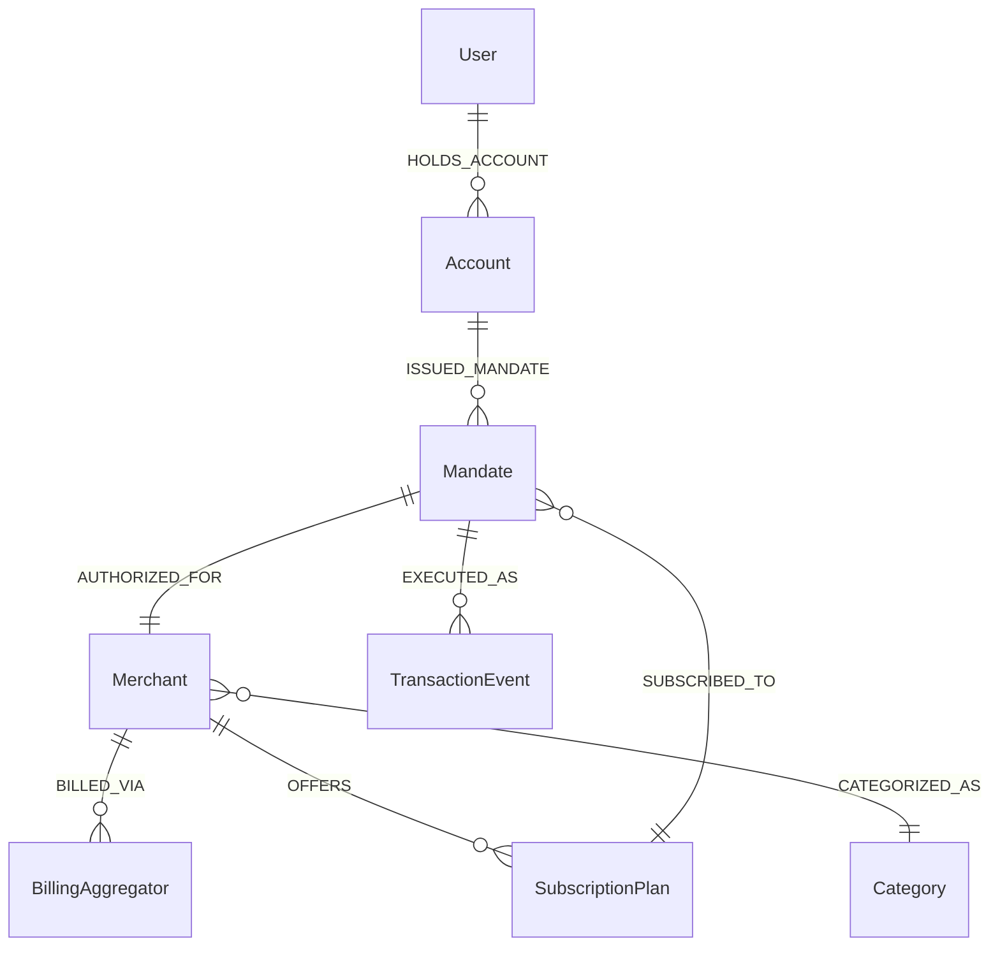
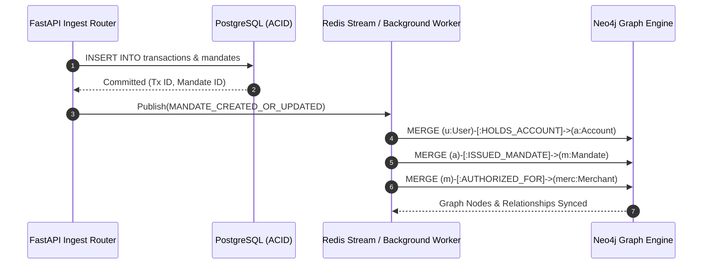

# Phase 10: Neo4j Graph Database Integration Architecture for Mandate Radar

**Target Application:** Mandate Radar  
**Primary Database:** PostgreSQL 16+  
**Graph Database:** Neo4j 5.x+ (Enterprise / Community)  
**Backend:** Python + FastAPI

---

## 1. Architectural Partitioning: PostgreSQL vs. Neo4j

A critical architectural pitfall in fintech is attempting to store double-entry ledger lines inside a graph database. Graph databases are optimized for **path traversal, topology, and relationship discovery**, whereas relational databases excel at **ACID transaction guarantees, strict schema constraints, arbitrary-precision decimal math, and audit immutability**.

```mermaid
flowchart TD
    subgraph PostgreSQL: System of Record & Ledger (ACID)
        P1[User Credentials & Auth]
        P2[Double-Entry Financial Ledgers]
        P3[Exact Signed Decimal Balances]
        P4[Raw Ingest Logs: SMS, PDF, MIME]
        P5[Audit Logs & Soft Delete Immutability]
    end

    subgraph Neo4j: System of Intelligence & Relationships (Graph)
        N1[Merchant Alias & Parent Hierarchy]
        N2[Payment Aggregator Networks]
        N3[Mandate & Subscription Topologies]
        N4[Cross-Channel Entity Resolution]
        N5[Zombie Subscription & Hidden Loop Detection]
    end

    FastAPI[FastAPI Backend / Celery Worker] -->|Writes Ledger Data| PostgreSQL
    FastAPI -->|Async Event Stream / CDC| Neo4j
```

### Partitioning Rules:
- **Keep in PostgreSQL:** `users`, `accounts`, `transactions` (exact debits/credits with `decimal(32,12)`), `raw_ingest_payloads`, `auth_tokens`.
- **Project into Neo4j:** `User`, `Account`, `Mandate`, `Merchant`, `BillingAggregator`, `SubscriptionPlan`, `Category`.

---

## 2. Graph Schema: Node Types & Properties



### 1. `(:User)`
- `id`: UUID (matches PostgreSQL `users.id`)
- `name`: String
- `risk_score`: Float

### 2. `(:Account)`
- `id`: UUID (matches PostgreSQL `accounts.id`)
- `bank_name`: String (e.g., `"HDFC Bank"`)
- `account_type`: String (`"SAVINGS"`, `"CREDIT_CARD"`, `"UPI_WALLET"`)
- `masked_number`: String (e.g., `"**4821"`)

### 3. `(:Mandate)`
- `id`: UUID (matches PostgreSQL `mandates.id`)
- `umn_or_umrn`: String (Unique Mandate Number or UMRN)
- `type`: String (`"UPI_AUTOPAY"`, `"E_NACH"`, `"CARD_SI"`)
- `max_amount`: Float
- `cadence`: String (`"MONTHLY"`, `"QUARTERLY"`, `"ANNUAL"`)
- `status`: String (`"ACTIVE"`, `"PAUSED"`, `"REVOKED"`, `"EXPIRED"`)
- `next_expected_date`: Date

### 4. `(:Merchant)`
- `id`: UUID
- `brand_name`: String (e.g., `"Netflix"`)
- `legal_name`: String (e.g., `"Netflix Entertainment Services India LLP"`)
- `domain`: String (`"netflix.com"`)
- `cancellation_difficulty`: String (`"EASY"`, `"MEDIUM"`, `"HARD"`)

### 5. `(:BillingAggregator)`
- `name`: String (e.g., `"Razorpay"`, `"Paytm"`, `"BillDesk"`, `"Cashfree"`)
- `vpa_prefix`: String (e.g., `"razorpay@icici"`, `"paytm-autopay@paytm"`)

### 6. `(:SubscriptionPlan)`
- `id`: UUID
- `plan_name`: String (e.g., `"Premium 4K Family"`)
- `standard_price`: Float (e.g., `649.00`)
- `billing_cycle`: String (`"MONTHLY"`)

### 7. `(:Category)`
- `name`: String (`"Entertainment"`, `"Software & Cloud"`, `"Fitness"`, `"Utilities"`)

---

## 3. Graph Relationships

| Relationship | Source Node -> Target Node | Properties | Description |
| :--- | :--- | :--- | :--- |
| `:HOLDS_ACCOUNT` | `(:User) -> (:Account)` | `created_at` | Links user to their financial accounts. |
| `:ISSUED_MANDATE` | `(:Account) -> (:Mandate)` | `created_date`, `verified_via` | Identifies which bank/card account backs the mandate. |
| `:AUTHORIZED_FOR` | `(:Mandate) -> (:Merchant)` | `registered_amount`, `cadence` | Links the mandate to the recipient brand. |
| `:SUBSCRIBED_TO` | `(:Mandate) -> (:SubscriptionPlan)` | `tier`, `current_rate` | Ties mandate to specific service tier. |
| `:BILLED_VIA` | `(:Merchant) -> (:BillingAggregator)` | `vpa_handle` | Represents intermediate payment gateway routing. |
| `:CATEGORIZED_AS` | `(:Merchant) -> (:Category)` | `confidence` | Categorization taxonomy. |
| `:CHARGED` | `(:Account) -> (:Merchant)` | `amount`, `date`, `ref_id`, `channel` | Historical payment events. |

---

## 4. High-Value Cypher Graph Queries

### Query 1: Detect Duplicate Subscriptions across Multiple Bank Accounts
Finds users who are unknowingly paying for the same merchant on two separate bank accounts or credit cards (e.g. paying for Hotstar on HDFC Savings AND on an ICICI Credit Card).

```cypher
MATCH (u:User {id: $user_id})-[:HOLDS_ACCOUNT]->(a:Account)
MATCH (a)-[:ISSUED_MANDATE]->(m:Mandate {status: 'ACTIVE'})-[:AUTHORIZED_FOR]->(merc:Merchant)
WITH u, merc, collect(DISTINCT a.bank_name) AS banks, collect(m) AS active_mandates, count(m) AS mandate_count
WHERE mandate_count > 1
RETURN 
    merc.brand_name AS merchant,
    mandate_count,
    banks,
    [m IN active_mandates | m.umn_or_umrn] AS mandate_identifiers,
    [m IN active_mandates | m.max_amount] AS amounts
```

---

### Query 2: Resolve Obscured Billing Aggregators to Canonical Merchants
When an incoming SMS states `Paid Rs 299 to RAZORPAY*ZEPTO`:

```cypher
MATCH (ba:BillingAggregator {name: 'Razorpay'})<-[:BILLED_VIA]-(m:Merchant)
WHERE $raw_memo CONTAINS toUpper(m.brand_name) OR $raw_memo CONTAINS toUpper(m.legal_name)
RETURN m.id AS merchant_id, m.brand_name AS brand, m.domain AS domain
LIMIT 1
```

---

### Query 3: Identify "Zombie" / Forgotten Subscriptions
Identifies active mandates where debit amounts have occurred regularly, but no linked Gmail digital activity, invoice receipts, or user interactions have occurred in the last 60 days.

```cypher
MATCH (u:User {id: $user_id})-[:HOLDS_ACCOUNT]->(a:Account)-[:ISSUED_MANDATE]->(m:Mandate {status: 'ACTIVE'})-[:AUTHORIZED_FOR]->(merc:Merchant)
MATCH (a)-[c:CHARGED]->(merc)
WITH u, m, merc, max(c.date) AS last_charge_date, count(c) AS total_charges
WHERE last_charge_date < date() - duration({days: 30})
  AND m.next_expected_date <= date() + duration({days: 7})
RETURN 
    merc.brand_name AS merchant,
    m.umn_or_umrn AS mandate_id,
    last_charge_date,
    m.next_expected_date AS upcoming_charge_date,
    m.max_amount AS amount
ORDER BY upcoming_charge_date ASC
```

---

### Query 4: Sudden Price Hike / Tier Drift Detection
Detects when the latest charge for a subscription exceeds the standard price of the linked `SubscriptionPlan`.

```cypher
MATCH (a:Account)-[:ISSUED_MANDATE]->(m:Mandate)-[:SUBSCRIBED_TO]->(p:SubscriptionPlan)
MATCH (a)-[c:CHARGED]->(merc:Merchant)<-[:OFFERS]-(p)
WHERE c.date >= date() - duration({days: 30})
  AND c.amount > p.standard_price * 1.05
RETURN 
    merc.brand_name AS merchant,
    p.plan_name AS plan,
    p.standard_price AS expected_amount,
    c.amount AS actual_charged_amount,
    (c.amount - p.standard_price) AS stealth_hike
```

---

## 5. PostgreSQL-to-Neo4j Synchronization Pipeline



- **Async Event Bus:** PostgreSQL transactions are committed first. A lightweight background worker (FastAPI BackgroundTasks or Celery with Redis) listens for financial events and projects entity nodes and relationships into Neo4j using idempotent `MERGE` Cypher statements.
- **Fail-Safe Guarantee:** If Neo4j is temporarily unreachable or undergoing maintenance, PostgreSQL financial ledgers remain completely unaffected. The sync queue replays events when the graph connection is restored.

