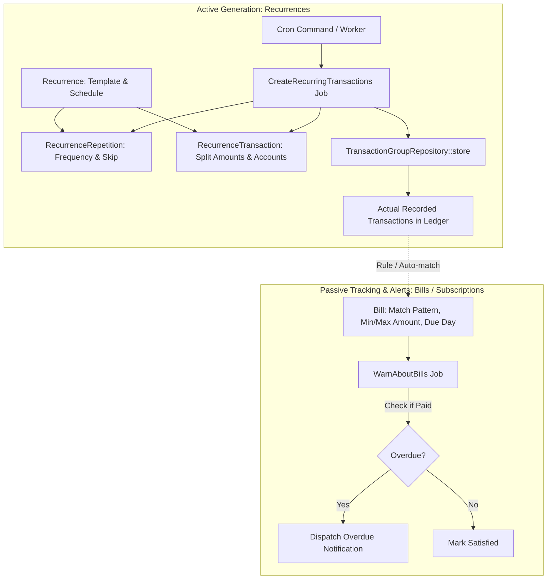
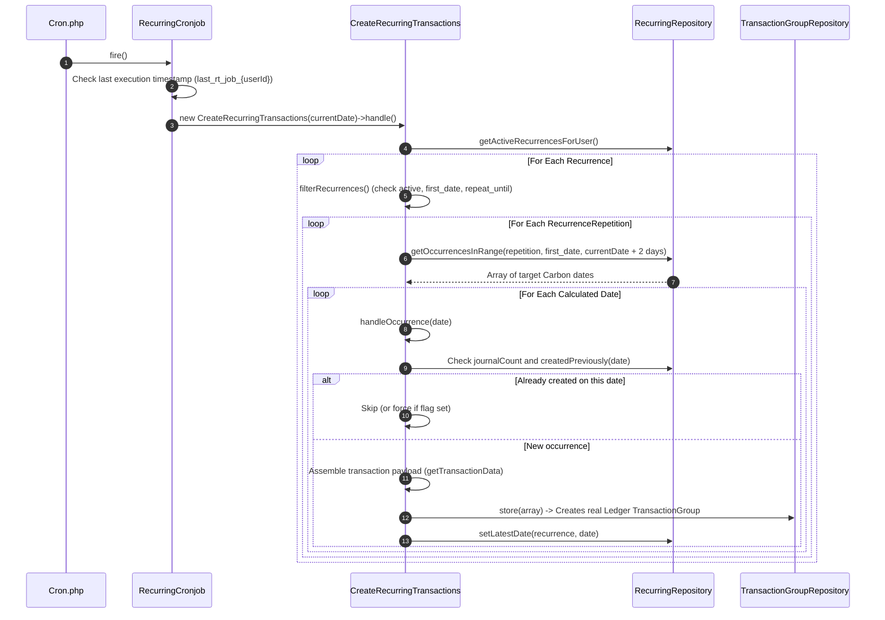

# Phase 3: Firefly III Recurring Transaction & Subscription Engine Analysis

**Target Application:** Firefly III  
**Workspace Location:** `e:\firefly-iii-main`  
**Key Sources Analyzed:**
- `app/Models/Recurrence.php`, `RecurrenceRepetition.php`, `RecurrenceTransaction.php`, `Bill.php`
- `app/Console/Commands/Tools/Cron.php`
- `app/Support/Cronjobs/RecurringCronjob.php`, `BillWarningCronjob.php`
- `app/Jobs/CreateRecurringTransactions.php`, `WarnAboutBills.php`
- `app/Repositories/Recurring/RecurringRepository.php`
- `app/Support/Repositories/Recurring/CalculateRangeOccurrences.php`, `CalculateXOccurrences.php`, `FiltersWeekends.php`
- `app/Services/Internal/Update/RecurrenceUpdateService.php`, `app/Services/Internal/Destroy/RecurrenceDestroyService.php`

---

## 1. High-Level Architecture: Recurrences vs. Bills

Firefly III provides two distinct abstractions for recurring finances:



1. **Recurrence (`recurrences` table):** An **active generator**. Firefly III automatically creates and inserts real transaction records into the ledger on schedule.
2. **Bill (`bills` table):** A **passive expectation tracker / subscription monitor**. It defines what payments *should* occur (e.g. "Netflix between 199 and 649 INR on the 15th"). Real transactions imported from banks or entered manually are linked to the bill. If a bill is not matched within its expected period, a warning is sent.

---

## 2. Recurring Transaction Data Models

### A. `Recurrence` (`app/Models/Recurrence.php`)
- **Table:** `recurrences`
- **Fields:**
  - `id`: Primary key
  - `user_id`, `user_group_id`: Scoping keys
  - `transaction_type_id`: Type (Withdrawal, Deposit, Transfer)
  - `title`, `description`: Human-readable identifiers
  - `first_date`, `first_date_tz`: When recurrence begins
  - `repeat_until`, `repeat_until_tz`: Expiration date (optional)
  - `latest_date`, `latest_date_tz`: High-water mark timestamp of the most recent execution
  - `repetitions`: Max execution limit counter (e.g., terminate after 12 installments)
  - `apply_rules`: Boolean flag (whether generated transactions run through the Rule Engine)
  - `active`: Boolean flag

### B. `RecurrenceRepetition` (`app/Models/RecurrenceRepetition.php`)
- **Table:** `recurrences_repetitions`
- **Fields:**
  - `recurrence_id`: Foreign key to `recurrences.id`
  - `repetition_type`: Frequency type enum (`daily`, `weekly`, `monthly`, `ndom`, `yearly`)
  - `repetition_moment`: Frequency modifier (e.g. `"15"` for 15th day; `"1,5"` for 1st Friday; `"1"` for Monday)
  - `repetition_skip`: Step increment (0 = every interval, 1 = every second interval, 2 = every third interval)
  - `weekend`: Weekend adjustment strategy (`1` = Do nothing, `2` = Skip creation, `3` = Shift to Friday, `4` = Shift to Monday)

### C. `RecurrenceTransaction` (`app/Models/RecurrenceTransaction.php`)
- **Table:** `recurrence_transactions`
- Stores the split template: `amount`, `source_id`, `destination_id`, `currency_id`, `foreign_amount`, `description`, etc.

---

## 3. Recurrence Scheduling & Execution Engine

### Execution Workflow (`CreateRecurringTransactions.php`)



### 1. The Cron Entry Point (`app/Console/Commands/Tools/Cron.php:198`)
- Handled via `firefly-iii:cron`.
- Calls `RecurringCronjob::fire()`.
- Throttles executions per user: checks `last_rt_job_{userId}`. By default, prevents re-running if less than 12 hours (43,200 seconds) have elapsed unless the `--force` flag is specified.

### 2. Date Evaluation & Frequencies (`CalculateRangeOccurrences.php`)
Located in `app/Support/Repositories/Recurring/CalculateRangeOccurrences.php`:

- **Daily (`getDailyInRange`):** Increments day-by-day:
  ```php
  while ($start <= $end) {
      if (0 === ($attempts % $skipMod)) { $return[] = clone $start; }
      $start->addDay();
      ++$attempts;
  }
  ```
- **Monthly (`getMonthlyInRange`):** Evaluates `dayOfMonth = (int) $moment`. Handles month length clamping:
  ```php
  $domCorrected = min($dayOfMonth, $start->daysInMonth);
  $start->day = $domCorrected;
  ```
  *(Crucial for fintech: if a mandate is set for the 31st, February executes on the 28th/29th).*
- **N-dom (`getNdomInRange`):** Evaluates expressions like "1st Monday" or "last Friday":
  - Takes `$parts = explode(',', $moment)` (e.g., `[1, 5]` for 1st Friday).
  - Uses Carbon semantic constructors:
    ```php
    $string = sprintf('%s %s of %s %s', $counters[$parts[0]], $daysOfWeek[$parts[1]], $start->format('F'), $start->format('Y'));
    $newCarbon = new Carbon($string);
    ```
- **Yearly (`getYearlyInRange`):** Fixed day and month recurrence.

### 3. Weekend Handling (`FiltersWeekends.php`)
Defined in `app/Enums/RecurrenceRepetitionWeekend.php`:
- `WEEKEND_DO_NOTHING = 1`: Executes on Saturday/Sunday regardless of banking hours.
- `WEEKEND_SKIP_CREATION = 2`: Suppresses execution if the date lands on a weekend.
- `WEEKEND_TO_FRIDAY = 3`: If Saturday or Sunday, executes on preceding Friday (`$date->subDays(...)`).
- `WEEKEND_TO_MONDAY = 4`: If Saturday or Sunday, executes on succeeding Monday (`$date->addDays(...)`).

---

## 4. Missed and Delayed Transactions Handling

When the cron job fails to run (e.g., server offline for 5 days):
1. `CreateRecurringTransactions::getStartDate()` inspects:
   ```php
   $startDate = clone $recurrence->first_date;
   if (null !== $recurrence->latest_date && $recurrence->latest_date->gte($startDate)) {
       return clone $recurrence->latest_date;
   }
   ```
2. The generator queries occurrences in the range between `latest_date` and the target date.
3. It iterates through all missed intervals and creates separate `TransactionGroup` records for each missed occurrence.
4. **Safety Check (`handleOccurrence`)**:
   - `createdPreviously(Recurrence $recurrence, Carbon $date)` inspects `journal_meta` to guarantee that transactions are never duplicated for the same target recurrence date.

---

## 5. Subscriptions & Bills Engine (`app/Models/Bill.php`)

### Fields:
- `name`: Subscription title (e.g. "Spotify Family")
- `match`: Comma-separated list of match patterns / regex tokens (e.g. `"Spotify,Spotify AB,Open.Spotify"`)
- `amount_min`, `amount_max`: Tolerance range (e.g., min: 119, max: 129)
- `repeat_freq`: Recurrence cadence (`weekly`, `monthly`, `quarterly`, `half-year`, `yearly`)
- `automatch`: Boolean flag for auto-linking newly imported transactions
- `active`: Boolean

### Overdue Alert Logic (`WarnAboutBills.php`)
1. Loops over active bills.
2. Checks whether any withdrawal matching the criteria occurred in the current billing window.
3. If no payment is detected and the billing date has passed, it dispatches:
   - `SubscriptionsAreOverdueForPayment`
   - `SubscriptionNeedsExtensionOrRenewal` (if `end_date` is approaching).

---

## 6. Critical Evaluation: Firefly III vs. Mandate Radar Needs

| Capability | Firefly III Recurring Engine | Mandate Radar Requirement |
| :--- | :--- | :--- |
| **Trigger Mechanism** | User manually creates template; Cron fires execution. | **Fully Automatic Discovery:** System detects recurrence from raw SMS/statement feeds without user setup. |
| **UPI AutoPay Support** | **None.** No concept of UMN, mandate limits, pre-debit notifications, or execution windows. | **Full Lifecycle:** UMN tracking, mandate status (Active, Paused, Revoked), pre-debit alert matching. |
| **Amount Variance** | Static amount in Recurrence; Min/Max range in Bill. | **Dynamic Price Creep Detection:** Tracks subscription tier upgrades, stealth fee hikes, currency drift. |
| **Cancellation** | Deleting recurrence deletes future cron generation. | **Active Cancellation Assistant:** Direct cancel deep-links (NPCI/Bank), cancellation scripts, auto-generated emails. |

