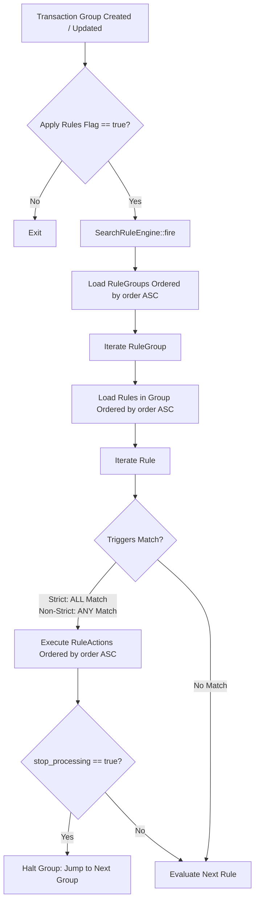
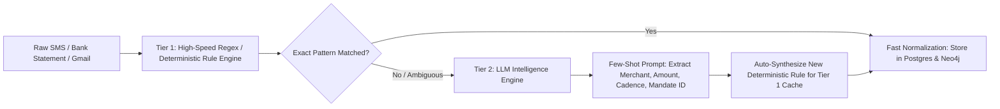

# Phase 4: Firefly III Rule Engine Analysis

**Target Application:** Firefly III  
**Workspace Location:** `e:\firefly-iii-main`  
**Key Sources Analyzed:**
- `app/TransactionRules/Engine/SearchRuleEngine.php`
- `app/TransactionRules/Engine/RuleEngineInterface.php`
- `app/TransactionRules/Engine/CustomExpressionLanguage.php`
- `app/TransactionRules/Expressions/ActionExpression.php`
- `app/TransactionRules/Factory/ActionFactory.php`
- `app/TransactionRules/Actions/*` (30+ action classes)
- `app/Models/Rule.php`, `RuleGroup.php`, `RuleTrigger.php`, `RuleAction.php`

---

## 1. Architectural Overview

Firefly III features an automated **Condition-Action Transaction Transformation Engine**. When a transaction is created or updated, or when triggered retroactively in batch, the Rule Engine evaluates matching criteria and modifies transaction attributes in-flight.



---

## 2. Rule Hierarchy & Data Models

1. **`RuleGroup` (`app/Models/RuleGroup.php`)**:
   - Encapsulates sets of rules (e.g., "Merchant Categorization", "Tax Rules", "UPI Mandate Parsing").
   - Controls top-level evaluation priority (`order`).
2. **`Rule` (`app/Models/Rule.php`)**:
   - Belongs to a `RuleGroup`.
   - Fields: `title`, `description`, `order`, `active`, `strict`, `stop_processing`.
   - **`strict` (Boolean):**
     - `true` (AND logic): All triggers must evaluate to true.
     - `false` (OR logic): Any single trigger evaluating to true activates the rule.
   - **`stop_processing` (Boolean):** If true, execution halts immediately for the remaining rules in the current group once this rule executes.
3. **`RuleTrigger` (`app/Models/RuleTrigger.php`)**:
   - Defines matching criteria: `trigger_type`, `trigger_value`, `order`, `active`.
4. **`RuleAction` (`app/Models/RuleAction.php`)**:
   - Defines mutations: `action_type`, `action_value`, `order`, `active`.

---

## 3. Rule Triggers (Condition Evaluation)

Firefly III implements a search-oriented evaluation strategy (`SearchRuleEngine.php`). Rather than parsing custom ASTs in memory for every trigger, triggers map directly to search operator queries:

### Common Supported Trigger Types:
- **Description Matching:** `description_is`, `description_contains`, `description_starts_with`, `description_ends_with`, `description_regex`
- **Account Filtering:** `from_account_is`, `from_account_starts`, `to_account_is`, `to_account_starts`
- **Monetary Constraints:** `amount_is`, `amount_more`, `amount_less`, `amount_between`
- **Metadata & Classification:** `has_tag`, `has_no_tag`, `has_category`, `has_no_category`, `has_budget`, `bill_is`
- **Transaction Types:** `transaction_type_is` (`withdrawal`, `deposit`, `transfer`)
- **Temporal Conditions:** `date_is`, `date_before`, `date_after`

### Execution Logic (`SearchRuleEngine.php:73-90`):
- `findStrictRule(Rule $rule)` constructs an intersection of query results for all triggers.
- `findNonStrictRule(Rule $rule)` constructs a union of query results.
- Returns matching `TransactionJournal` collections.

---

## 4. Rule Actions & Mutation Operations

Located in `app/TransactionRules/Actions/*`:

| Action Class | Functionality |
| :--- | :--- |
| `SetCategory.php` | Links or creates a category and attaches it to the journal. |
| `SetBudget.php` | Sets the budget allocation (valid for withdrawals). |
| `LinkToBill.php` | Links transaction to an existing `Bill` (subscription). |
| `SetDescription.php` | Overwrites description (can be formatted dynamically). |
| `AppendDescription.php` / `PrependDescription.php` | Appends or prepends text to transaction descriptions. |
| `MoveDescriptionToNotes.php` | Moves messy bank memo text to private notes. |
| `SetSourceAccount.php` / `SetDestinationAccount.php` | Reassigns or creates accounts (e.g., standardizing merchant names). |
| `SwitchAccounts.php` | Swaps source and destination accounts. |
| `ConvertToTransfer.php` / `ConvertToDeposit.php` | Changes transaction typology and recalculates ledger postings. |
| `AddTag.php` / `RemoveTag.php` | Tag lifecycle management. |

---

## 5. Advanced Dynamic Evaluation: Symfony Expression Language

Firefly III integrates `symfony/expression-language: ^8.0` inside `RuleAction.php` and `app/TransactionRules/Expressions/ActionExpression.php`.

### How it Works:
If `enable_expression_engine` is active:
- If `action_value` starts with `\=`, it treats the value as a literal string.
- Otherwise, it compiles and evaluates the string as an expression with access to the transaction attributes (`journal['amount']`, `journal['description']`, `journal['date']`).

### Example Expression:
```text
"Subscription fee for " ~ journal.destination_account ~ " on " ~ journal.date
```
This enables dynamic computed descriptions, tags, and amounts.

---

## 6. Conflict Resolution & Execution Order

1. **Determinism:** Execution strictly follows `rule_groups.order ASC` -> `rules.order ASC` -> `rule_actions.order ASC`.
2. **Short-Circuiting:** If a rule with `stop_processing = true` fires, subsequent rules in that specific group are skipped. Execution then moves to the next `RuleGroup`.
3. **Database Consistency:** When actions modify core ledger topology (such as `ConvertToTransfer` or `SwitchAccounts`), the action re-invokes `TransactionFactory` to update debit/credit records safely.

---

## 7. Architectural Blueprint for Mandate Radar's Intelligence Engine

Firefly III's Rule Engine is well-architected for deterministic user-defined rules, but has significant limitations for a modern fintech app:

### Limitations of Firefly III's Approach:
1. **Rule Fatigue:** The user must manually write regex and string rules for every merchant.
2. **Brittle Bank Memos:** Indian UPI/bank statements format merchant names inconsistently (e.g., `UPI/432109876543/PAYTM*NETFLIX/paytm-netflix@hdfc/Payment`). Manual string matching requires dozens of brittle rules.
3. **No Semantic Awareness:** Cannot infer that `Amazon Prime`, `Prime Video`, and `Amazon Digital Svcs` belong to the same subscription entity.

### Mandate Radar Dual-Engine Architecture:
Mandate Radar should implement a **Two-Tier Hybrid Intelligence Pipeline**:



1. **Tier 1 (Deterministic Engine):** Python-based rule engine mirroring Firefly III's triggers and actions for high-frequency known patterns (zero API cost, sub-millisecond execution).
2. **Tier 2 (LLM Intelligence Engine):** When Tier 1 has no match or low confidence, pass raw text to FastAPI's LLM engine (Gemini Flash) to extract merchant, mandate tokens (UMN/UMRN), recurrence frequency, and category. Automatically compile the LLM's finding into a Tier 1 rule to accelerate future queries.

