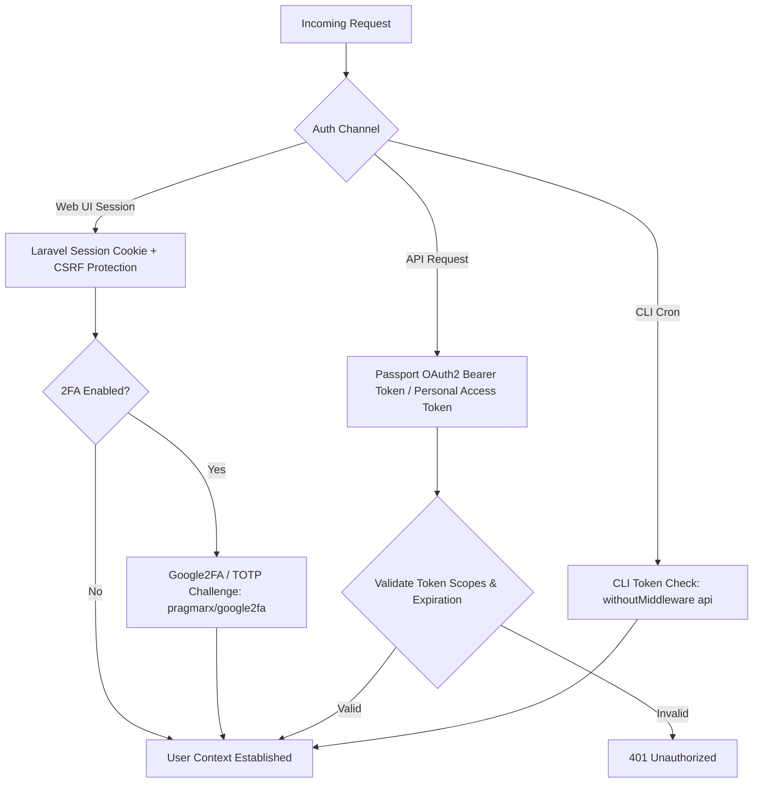
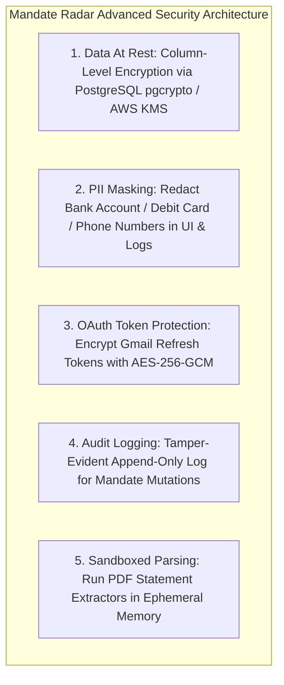

# Phase 8: Firefly III Security Architecture Analysis

**Target Application:** Firefly III  
**Workspace Location:** `e:\firefly-iii-main`  
**Key Sources Analyzed:**
- `app/Services/Password/PwndVerifierV2.php`
- `config/hashing.php`, `config/auth.php`, `config/cors.php`
- `app/Http/Middleware/*`, `app/Api/V1/Middleware/*`
- `app/Models/TransactionJournal.php:79` (RouteBinders)
- `database/migrations/2018_01_01_*` (Passport OAuth tables)

---

## 1. Authentication Mechanisms

Firefly III supports a multi-layered authentication strategy:



1. **Stateful Web Authentication:** Standard HTTP session cookie secured with `SameSite=Lax/Strict`, `HttpOnly`, and HTTPS encryption.
2. **Stateless API Authentication:** Implements OAuth2 through `laravel/passport`. Tokens are stored in hashed formats within `oauth_access_tokens` and verified per request.
3. **Two-Factor Authentication (2FA):** Integrated via `jc5/google2fa-laravel` and `pragmarx/google2fa`. Supports standard RFC 6238 TOTP algorithms (compatible with Google Authenticator, Authy, Bitwarden).
4. **Header Sandboxing:** Sandboxing middleware injects strict Content Security Policy (`CSP`), `X-Frame-Options: DENY`, `X-Content-Type-Options: nosniff`, and `Referrer-Policy: strict-origin-when-cross-origin`.

---

## 2. Authorization & Data Isolation

### Scoped Data Access:
Firefly III enforces **strict multi-tenant / multi-user data isolation**:
- Every query is explicitly scoped to the authenticated user ID:
  ```php
  $user->transactionJournals()->where('transaction_journals.id', $journalId)->first();
  ```
- **Implicit Route Binding with Security Checks:** Models implement custom `routeBinder()` methods (e.g. `TransactionJournal::routeBinder()`). If a user attempts to access a valid transaction ID that belongs to another user, the binder throws `NotFoundHttpException` (404) rather than 403 Forbidden, preventing ID enumeration attacks.
- **Role-Based Access Control (RBAC):** Supports `UserGroup` sharing for multi-user households, with permission roles (`owner`, `member`, `guest`) managed via `app/Repositories/UserGroup/`.

---

## 3. Password Security & Breached Credential Auditing

### A. Modern Hashing Algorithms (`config/hashing.php`)
- Supports `bcrypt`, `argon`, and `argon2id`.
- Defaults to Bcrypt with configurable cost factors, or Argon2id with tunable memory (`65536 KB`), time (`4`), and thread (`1`) limits.

### B. Compromised Password Detection (`PwndVerifierV2.php`)
- Source: `app/Services/Password/PwndVerifierV2.php`
- When a user registers or changes passwords, Firefly III executes a **K-Anonymity check** against the HaveIBeenPwned API:
  ```php
  $hash   = sha1($password);
  $prefix = substr($hash, 0, 5);
  $rest   = substr($hash, 5);
  $url    = sprintf('https://api.pwnedpasswords.com/range/%s', $prefix);
  ```
- Only the first 5 characters of the SHA-1 hash are transmitted. The remote API returns all matching suffix hashes, and Firefly III performs local comparison. If the password was ever leaked in public breaches, registration is blocked.

---

## 4. Input Validation & SQL Injection Defense

1. **FormRequest Whitelisting:** All endpoints reject unlisted input fields. Dynamic SQL interpolation is completely prohibited.
2. **PDO Prepared Statements:** Database interactions utilize Laravel Eloquent and PDO parameterized queries, eliminating SQL injection risks.
3. **AST Validation on Search:** Search expressions entered into `OperatorQuerySearch` pass through `gdbots/query-parser`, sanitizing raw strings into typed tokens before constructing SQL queries.

---

## 5. Handling of Sensitive Financial Information (PII)

1. **High-Precision Financial Storage:** All amounts use `decimal(32, 12)`, preventing floating-point overflow or rounding truncation.
2. **Account Identifiers:** IBAN, BIC, and account numbers are stored in plain database columns by default.
3. **Database Field Encryption History:** Earlier Firefly versions featured app-level AES encryption (`$hidden = ['encrypted']`). However, full database column encryption was partially rolled back in modern versions (`RemovesDatabaseDecryption.php`) due to severe query performance degradation during cross-table index scans.

---

## 6. Fintech Security Blueprint for Mandate Radar

Financial apps operating in the Indian banking and UPI mandate ecosystem face strict regulatory and compliance requirements (RBI Digital Lending and Mandate Guidelines, DPDP Act 2023):



### Mandate Radar Security Implementation Checklist:
1. **Gmail OAuth Token Security:** Users connecting Gmail grant access to read financial receipts. Refresh tokens **must never be stored in plain text**. Use AES-256-GCM authenticated encryption with keys rotated via HashiCorp Vault or AWS KMS.
2. **Zero-Retention for Raw Statements:** Bank statement PDFs uploaded by users must be parsed in ephemeral memory or deleted immediately after transaction extraction. Store only normalized transaction tokens.
3. **Strict Masking:** Mask account numbers and UMN/UMRN tokens in UI displays (e.g., `HDFC Bank **4821`, `UMN: **********3912`).
4. **JWT + Revocation Lists (FastAPI):** Use short-lived JWT access tokens (15 minutes) with rotating refresh tokens stored in Redis with fingerprint binding (User-Agent + IP hash).

