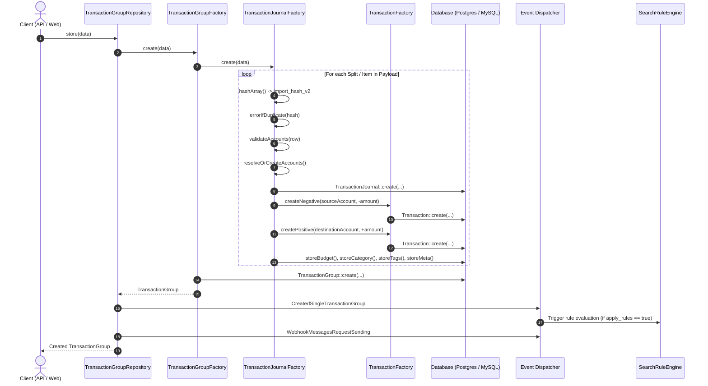

# Phase 2: Firefly III Transaction Management Engine Analysis

**Target Application:** Firefly III  
**Workspace Location:** `e:\firefly-iii-main`  
**Key Sources Analyzed:**
- `app/Repositories/TransactionGroup/TransactionGroupRepository.php`
- `app/Factory/TransactionGroupFactory.php`
- `app/Factory/TransactionJournalFactory.php`
- `app/Factory/TransactionFactory.php`
- `app/Models/TransactionGroup.php`, `TransactionJournal.php`, `Transaction.php`
- `app/Support/Search/OperatorQuerySearch.php`

---

## 1. Transaction Architecture & Double-Entry Design

Firefly III avoids simplistic "flat" transaction records. Instead, it implements a **three-tier double-entry ledger**:

```text
[TransactionGroup] (Envelope / Multi-split Container)
       │
       └── 1..* [TransactionJournal] (Logical Event: Date, Description, Currency, Bill)
                     │
                     ├── [Transaction] (Negative amount: Debit from Source Account)
                     └── [Transaction] (Positive amount: Credit to Destination Account)
```

### Core Entities:
1. **`TransactionGroup` (`app/Models/TransactionGroup.php`)**: Represents the user action or payment event. Can hold a single transaction or multiple splits.
2. **`TransactionJournal` (`app/Models/TransactionJournal.php`)**: Contains business context: description, transaction date, timezone (`date_tz`), currency ID, bill reference (`bill_id`), and category linkages.
3. **`Transaction` (`app/Models/Transaction.php`)**: The physical ledger line item tied to an individual `Account`. For standard single-split transactions, exactly two `Transaction` records exist per `TransactionJournal`:
   - One negative row linked to the source account (e.g., `-50.00`).
   - One positive row linked to the destination account (e.g., `+50.00`).

---

## 2. Complete Transaction Creation Lifecycle

The lifecycle follows a deterministic path from API/Controller through Factory, Repositories, and Observers:



### Step-by-Step Code Walkthrough:

#### A. Entry & Orchestration (`TransactionGroupRepository.php:349`)
- Function: `public function store(array $data): TransactionGroup`
- Injects `TransactionGroupFactory::class`.
- Passes user and user group context:
  ```php
  $factory->setUser($data['user']);
  $factory->setUserGroup($data['user_group']);
  $transactionGroup = $factory->create($data);
  ```
- Dispatches domain events:
  - `CreatedSingleTransactionGroup($flags, $objects)`
  - `WebhookMessagesRequestSending()`

#### B. Group & Journal Creation (`TransactionGroupFactory.php:57` & `TransactionJournalFactory.php:109`)
- Function: `TransactionJournalFactory::create(array $data): Collection`
- Loops over `$data['transactions']` and calls `createJournal(NullArrayObject $row)`.
- If an exception occurs, `forceDeleteOnError($collection)` executes a rollback, deleting any half-persisted journals.

#### C. Deduplication via Hash (`TransactionJournalFactory.php:233`, `525`)
- Computes SHA-256 fingerprint:
  ```php
  $row['import_hash_v2'] = $this->hashArray($row);
  ```
- `hashArray(NullArrayObject $row)` unsets ephemeral keys (`import_hash_v2`, `original_source`, `batch_submission`), serializes to JSON, and hashes with SHA-256.
- `errorIfDuplicate(string $hash)` queries `journal_meta` joined with `transaction_journals`. If `data = json_encode($hash)` exists for this user, it raises `DuplicateTransactionException`.

#### D. Account Validation and Auto-Creation (`TransactionJournalFactory.php:260-300`)
- `validateAccounts($row)` checks account permissions, IBAN formatting, and type compatibility.
- `getAccount($type, $direction, $info)` resolves existing accounts by ID, name, or IBAN. If an external merchant or revenue source does not exist, Firefly III **automatically provisions the Account** (e.g., an Expense Account for a new vendor).

#### E. Twin Ledger Entries Creation (`TransactionJournalFactory.php:350-410`)
- Instantiates `TransactionFactory`:
  ```php
  // Negative ledger entry (Debit source)
  $transactionFactory->setAccount($sourceAccount);
  $negative = $transactionFactory->createNegative((string) $row['amount'], (string) $row['foreign_amount']);

  // Positive ledger entry (Credit destination)
  $transactionFactory->setAccount($destinationAccount);
  $transactionFactory->createPositive($amount, $foreignAmount);
  ```

---

## 3. Transaction Validation Engine

Located in `app/Validation/AccountValidator.php` and `TransactionJournalFactory.php`:
1. **Reconciliation Check (`reconciliationSanityCheck`)**: For `reconciliation` type transactions, ensures balance corrections only happen between an Asset Account and the dedicated reconciliation settlement account.
2. **Account Direction Verification**:
   - `withdrawal`: Source must be an `Asset` or `Liability` account; Destination must be an `Expense` or `Cash` account.
   - `deposit`: Source must be a `Revenue` account; Destination must be an `Asset` account.
   - `transfer`: Both Source and Destination must be `Asset` or `Liability` accounts.
3. **Currency Alignment (`getCurrencyByAccount`)**: Verifies if the source account has a designated native currency (e.g., INR) and ensures currency conversion rates are recorded when foreign currencies differ.

---

## 4. Transaction Categorization & Metadata Engine

Stored in `TransactionJournalFactory.php:390-410`:
- **Categories:** Linked via many-to-many pivot `category_transaction_journal`.
- **Budgets:** Linked via `budget_transaction_journal` (only valid for withdrawal transactions).
- **Tags:** Extracted via `TagFactory`, attached via polymorphic or pivot relations.
- **Custom Metadata (`journal_meta` table):** Stores SEPA mandate IDs (`sepa_ci`, `sepa_db`), external transaction references (`external_id`), Bunq payment IDs, and recurrence tokens (`recurrence_id`).

---

## 5. Transfers & Multi-Currency Handling

When a transfer occurs between accounts with different currencies:
- Firefly III swaps currency information on the positive transaction leg (`TransactionJournalFactory.php:375-388`).
- Source transaction records the amount in source currency (e.g., `USD 100`).
- Destination transaction records the amount in destination currency (e.g., `EUR 92`).
- Both records preserve `foreign_amount` and `foreign_currency_id`, allowing real-time exchange gain/loss calculations without breaking balance sheets.

---

## 6. Transaction History and Running Balances

Firefly III avoids storing pre-baked running balances directly in every transaction row to prevent race conditions during retro-dated imports.
- Instead, balances are calculated on-the-fly or updated via `app/Console/Commands/System/RecalculatesRunningBalance.php`.
- `PeriodStatisticRepository` aggregates periodic totals (daily, weekly, monthly sums) for quick retrieval on dashboards.

---

## 7. Transaction Searching & Filtering Engine

Located in `app/Support/Search/OperatorQuerySearch.php` and `QueryParser`:
- Firefly III implements a mini query language parser (`gdbots/query-parser`).
- Supports queries such as:
  ```text
  type:withdrawal amount_more:500 date_after:2026-01-01 account:"HDFC Bank"
  ```
- Evaluates AST nodes (`FieldNode`, `StringNode`, `NodeGroup`) and translates them into SQL WHERE clauses on `transaction_journals` and `transactions`.

---

## 8. Implications for Mandate Radar

| Firefly III Architecture | Mandate Radar Adaptation |
| :--- | :--- |
| **Double-Entry (Journal + Transactions)** | **Keep in PostgreSQL:** Mandate payments must debit the user's Bank/UPI Account and credit the Merchant Account. |
| **`import_hash_v2` Deduplication** | **Upgrade to Fuzzy Deduplication:** Exact SHA-256 fails when SMS timestamp differs by seconds from Bank Statement date. Mandate Radar requires window-based fuzzy hashing (Amount + Merchant Normalization + ±2 day window). |
| **Auto-Account Creation** | **Essential for Merchants:** When an SMS mentions "Netflix", automatically create or link the Merchant entity. |
| **AST Query Parser** | **Adopt in FastAPI:** Use Pydantic + SQLModel/SQLAlchemy to provide structured filtering like `mandate_status:active amount:>299`. |

